

Introduction à la philologie computationnelle

# Entraîner un modèle

Simon Gabay

---
# Logique d'entraînement

---
## L'apprentissage automatique

L'apprentissage machine (ou automatique) se fonde sur des approches mathématiques et statistiques pour donner aux ordinateurs la capacité d'« apprendre » à partir de données, c'est-à-dire d'améliorer leur performance à résoudre des tâches sans être explicitement programmés pour chacune.

Il existe plusieurs méthodes:
* Machines à vecteurs de support
* Méthodes statistiques
* Les réseaux de neurones
* …

---
## Vers l'apprentissage profond

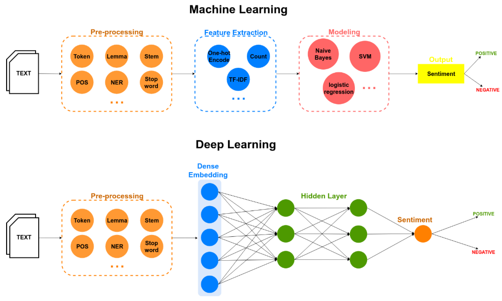

---
## Apprendre pour une machine

Pour apprendre à une machine à faire quelque chose, on a deux possibilités:
1. Donner des règles à la machine: _suivons_ a pour lemme _suivre_. Le problème c'est qu'il existe des cas ambigus: _suis_? Il faut alors rajouter des règles toujours plus complexes
2. Donner des exemples à la machine, qui va déduire des règles à partir des exemples: _je suis un homme_ -> _être_ vs _je suis le cours_ -> _suivre_. Le problème c'est qu'il faut beaucoup d'exemples

Nous allons ici suivre la seconde méthode, qui est plus efficace. Il va donc nous falloir des exemples

---
## Préparer un dataset
Il va nous falloir trois jeux de données:
* Pour l'entraînement: les données sont regardées par la machine pour déduire les règles
* Pour la validation: les données sont utilisées pour contrôler l'aprentissage sur les données d'entraînement à chaque itération, avec le risque que la machine se mette à bachoter
* Pour le test final: les données, qui n'ont jamais été vues pendant l'entraînement, vont permettre de contrôler la qualité finale

---
## Faire le _split_

La répartition des données dans les trois jeux dépend de la quantité de données à disposition

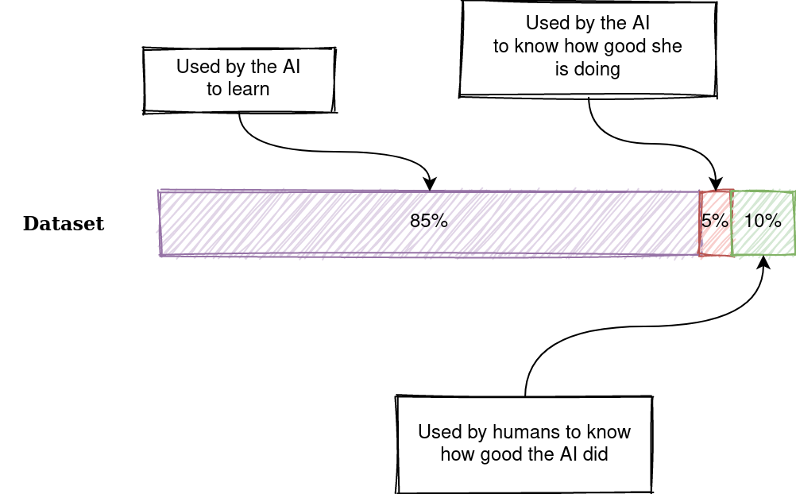

---
## Entraînement d'un modèle

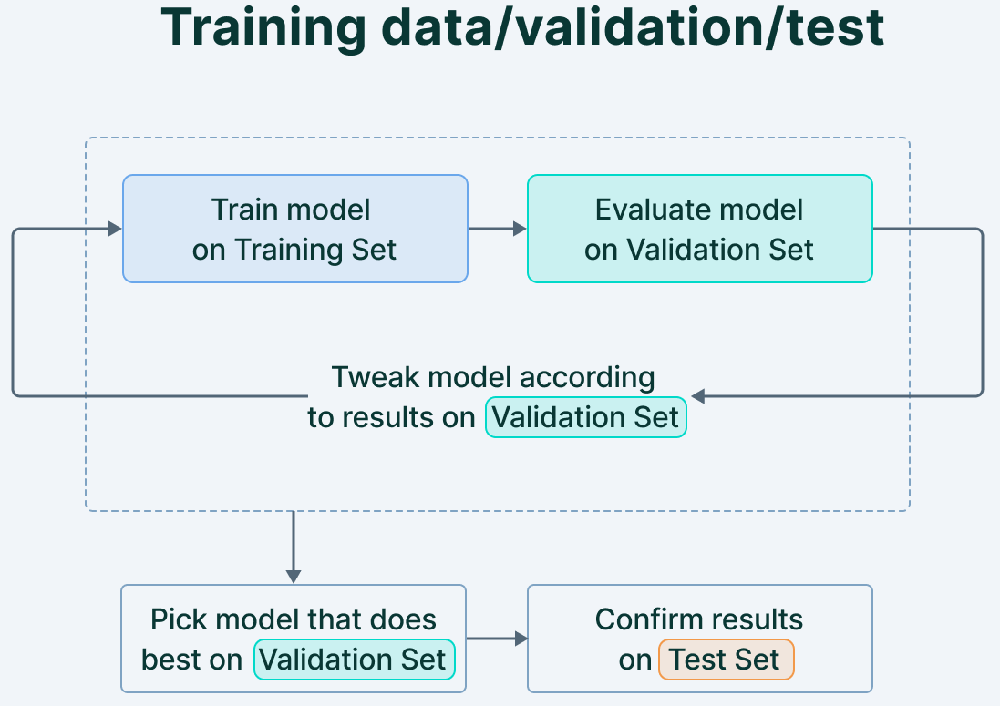

---
## Le règne de la quantité

L'IA est extrêmement gourmande en données: le plus c'est le mieux, il en faut donc un maximum. Il peut donc être utile de mutualiser les données, comme le propose le projet _HTR United_:

https://htr-united.github.io

Mais pour partager des données, il faut qu'elles soient compatibles entre elles, tant du point de vue du format que de l'annotation:
* On ne peut pas mélanger des données en ALTO et en PAGExml
* Si certains transcrivent _v_ et d'autres _u_ c'est potentiellement un problème
* Si certains distinguent les colonnes et d'autre pas ça ne va pas
* …

---
## Tests
Le score du test n'a pas de valeur en soi, il dépend:
* Des données d'entraînement
* Des données dans le jeu de test

99% sur un texte ne vaut pas (forcément) 99% sur un autre texte.

Pour le test, on peut utiliser des données:
* _In domain_: elles sont proches du jeu d'entraînement (tirées du même livre par exemple)
* _Out of domain_: elles sont différentes du jeu d'entraînement -- la question étant de savoir jusqu'à quel point différentes

---
## Evaluer le résultat
* La précision (_precision_) est le ratio du nombre de vrais positifs par rapport au nombre total de prédictions positives. Le nombre de fois où il a bien reconnu _être_ par rapport au nombre de fois où il a cru le reconnaître.
* Le rappel (_recall_) est le ratio du nombre de vrais positifs par rapport au nombre total d’objets réels (pertinents). Sur toutes les occurrences d'_être_, combien il en a retrouvées.
* l'exactitude (_accuracy_) est le nombre de prédictions correctes (vrais positifs+vrais négatifs) par rapport au nombre total de prédictions. Le nombre de fois où il ne s'est pas trompé en reconnaissant, ou en ne reconnaissant pas être.

---
## Le résultat

On utilise pour évaluer un modèle un score dit "F1", calculé à partir de la précision (_precision_) et du rappel (_recall_):
* Le rappel calcule le nombre de positifs bien prédits par notre modèle.
* La précision calcule le nombre de prédictions positives bien effectuées.

On parle donc:
* De faux négatif, quand le résultat est déclaré positif mais est en réalité négatif. La machine s'est trompée.
* De vrai négatif, quand le résultat est déclaré négatif mais est en réalité positif. La machine a oublié quelque chose.

---

---
## IoU

On utilise aussi l'intersection sur l'union (_Intersection over union_), plus adapté pour des zones (sur une page par exemple).

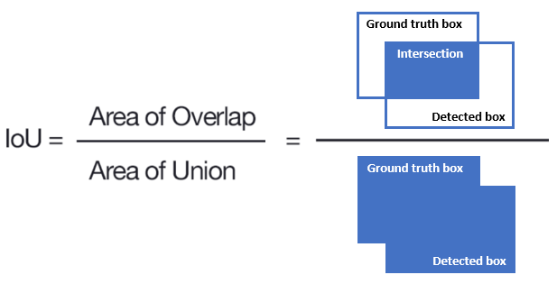

---

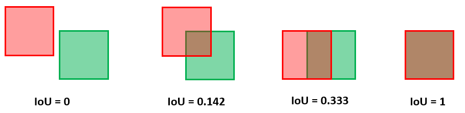

---
## Cycle d'amélioration d'un modèle

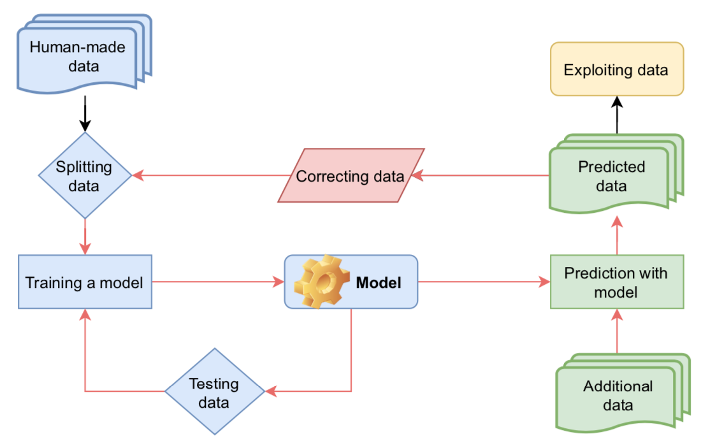

---
# Déroulé de l'entraînement

---
## Un peu de vocabulaire
* Une époque (_epoch_) correspond au passage de l'entièreté du jeu de _train_ à travers le réseau de neurones
* La taille de lot (_batch size_) est le nombre d'exemples du jeu de _train_ montré à la machine avant la mise à jour du modèle.
* L'itération (_iteration_) correspond au nombre de _batches_ pour compléter une époque.

Si j'ai 1000 exemples, en faisant des lots de 250 il me faudra 4 itérations avant de compléter 1 époque.

La taille de _batch_ a un impact direct sur les performances du modèles.

---
## Un peu plus de vocabulaire

* Modèle: somme de ce qui a été appris par la machine au cours de l'apprentissage
* Itération: cycle d'entrainement pendant le quel l'ordinateur voit toutes les données d'entraînement
* Surentraînement (_overfitting_): à force d'être évaluée sur le même jeu de validation à chaque itération, la machine se met à n'apprendre que pour passer ce test
* Généralisation: capacité du modèle à traiter des données qu'il n'a jamais vues.
* Arrêt prématuré (_early stopping_): arrêt de l'entraînement avant le surentraînement
* _Fine tuning_: on repart depuis un modèle déjà entraîné, auquel on ajoute une couche d'information

---
## Elle descend de la montagne à cheval

Le processus d'apprentissage correspond à la descente d'un marcheur vers le point le plus bas de la vallée:
1. Je le localise le point le plus bas
2. J'avance un bout de chemin
3. Je m'arrête pour réajuster mon chemin
4. Et ainsi de suite jusqu'à ce que j'arrive en bas

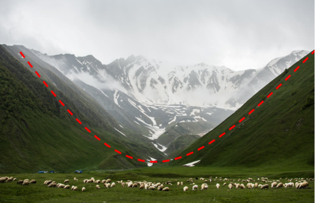

---
## Fonction de coût

En montagne: notre objectif est d'arrivée à distance de zéro entre l'endroit où je me trouve et l'endroit oùe je veux aller.

En ML: la fonction de perte (ou de coût, _loss function_) est la quantification de l’écart entre les prédictions du modèle et les observations annotées. L'objectif est d'atteindre zéro.

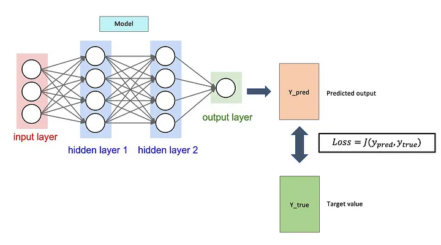

---
## Descente de gradient

En montagne: on est perdu et on mesure la valeur de la pente pour redescendre pour atteindre le point le plus bas de la vallée.

En ML: la descente de Gradient (_gradient descent_) est un algorithme qui permet de trouver le minimum de n’importe quelle fonction convexe (comme celle de coût) en convergeant progressivement vers celui-ci.

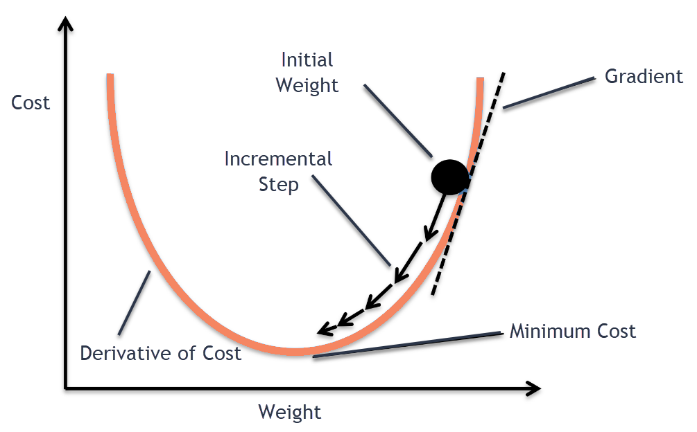

---
## Taux d'apprentissage

En montagne: on doit descendre progressivement vers le bas de la vallée. Quelle est la distance à parcourir à chaque étape pour ne pas dépasser le point le plus bas de la vallée, mais y aller le plus vite possible?

En ML: le taux d'apprentissage (_learning rate_) est un hyperparamètre qui joue sur la rapidité de la descente de gradient, soit la rapiditié/amplitude avec laquelle la valeur des paramètres de notre modèle est ajustée.

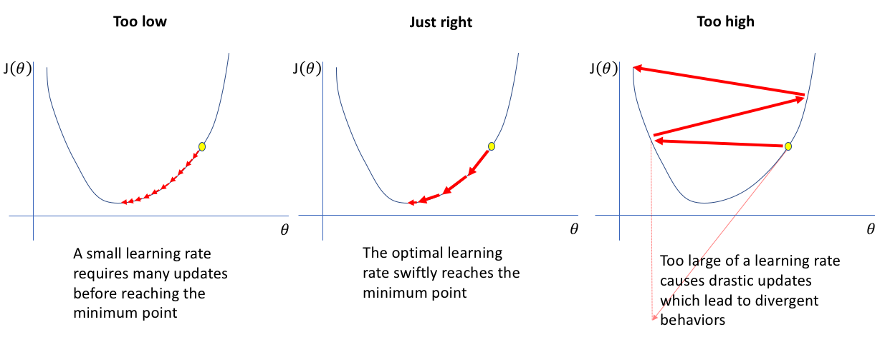

---
## Rétropropagation

En montagne: je me suis trompé de chemin, je corrige ma trajectoire.

En ML: la rétropropagation (_backpropagation_) calcule, de la dernière couche vers la première, comment les poids ont contribué à cette erreur et dans comment les modifier.

La mise à jour des poids de chaque neurone est faite par l'optimiseur, afin de corriger les erreurs de prédiction.

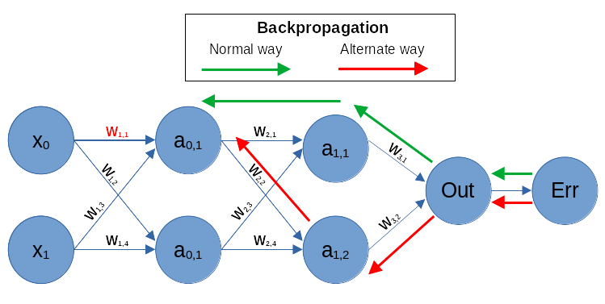

---
## Optimiseur

En montagne: plutôt que de parcourir la même distance à chaque étape de ma descente, je vais ajuster la distance à chaque étape en fonction de ma situation.

En ML: l’optimiseur détermine comment et de combien modifier les poids lors de la descente de gradient.
* La descente est dite "stochastique", car elle calcule le gradient, c’est-à-dire comment corriger la trajectoire, en fonction d’un échantillon et non de la totalité des données.
* L'optimiseur est dit "adaptatif" lorsqu’il ajuste les mises à jour en tenant compte, notamment, des gradients et des mises à jour précédentes.

L’un des optimiseurs les plus utilisés est "Adam" ([Kingma 2014](https://arxiv.org/abs/1412.6980)).

---
## La patience

En montagne: cela fait plusieurs étapes que je n'arrive pas à descendre significativement, je vais donc diminuer la longueur de mes étapes pour arriver à trouver le bon chemin. Je tâtonne.

En ML: après un nombre _n_ d'époques sans amélioration, je diminue le taux d'apprentissage.

---
## Sur- et sous-apprentissage

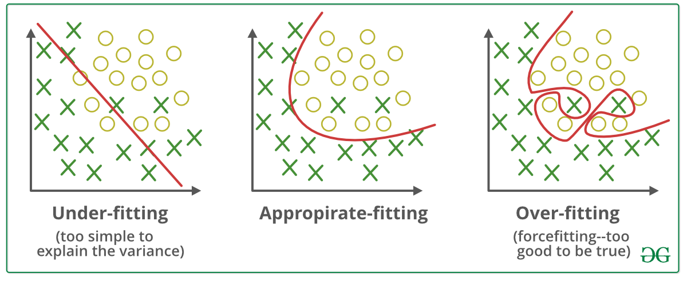

* La généralisation désigne la capacité d'un modèle à effectuer de bonnes prédictions sur des données qu'il n'a pas vu pendant la procédure d'entraînement.
* Le surapprentissage apparaît quand le résultat correspond trop préciséement à un ensemble de données et n'est pas généralisable à des observations supplémentaires et/ou futures.
* Le sous-apprentissage est le phénomène inverse: le modèle n'arrive même pas à produire de bonnes prédictions avec les données d'entraînement

---
# Approche par séquence

---
## Génération de séquence

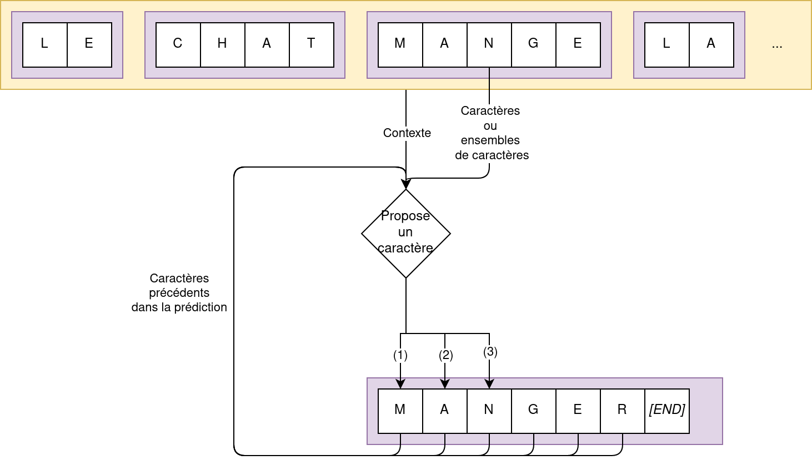

---
## Architecture encodeur-décodeur

Un Encodeur-Décodeur est un modèle de _deep Learning_ composé de deux réseaux de neurones, qui fonctionne de manière inversée:
* Le premier réseau (encodeur) prend en entrée du texte (caractère, mot…) et produit une séquence de chiffres
* Le second réseau (décodeur) reprend cette séquence chiffrée et la transforme en texte.

L'intérêt de cette architecture est que la taille de l'entrée n'est pas nécessairement la même que pour la sortie (_est_->_être_ / _je suis étudiant_->_I am a student_)

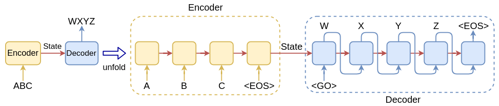

---
## Modèle séquence à séquence (dit _seq2seq_)

Le cœur de l'architeture _seq2seq_ ([Sutskever 2014](https://dl.acm.org/doi/10.5555/2969033.2969173)) est "l'état caché" (_hidden state_).
* L’encodeur traite chaque élément de la séquence d’entrée, compile les informations qu’il capture dans un vecteur (appelé le vecteur de contexte ou d’état caché) qui contient toutes les informations décrivant la séquence.
* L'encodeur envoie ensuite le vecteur de contexte au décodeur, qui commence à produire la séquence de sortie élément par élément.

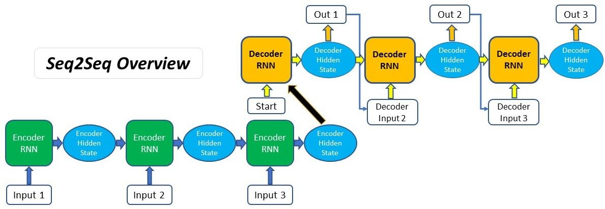

---
## Attention

Si la séquence d'entrée est trop longue, le vecteur se met à contenir trop d'information dont il ne sait que faire. [Bahdanau 2014](https://arxiv.org/abs/1409.0473) propose la méthode suivante:
* Ce n'est plus le dernier état caché qui est transmis au décodeur, mais tous les états cachés (il y a beaucoup plus d'information)
* On attribue un _scoring_ à chaque état caché pour produire un vecteur de contexte, qui met en valeur les éléments les plus importants

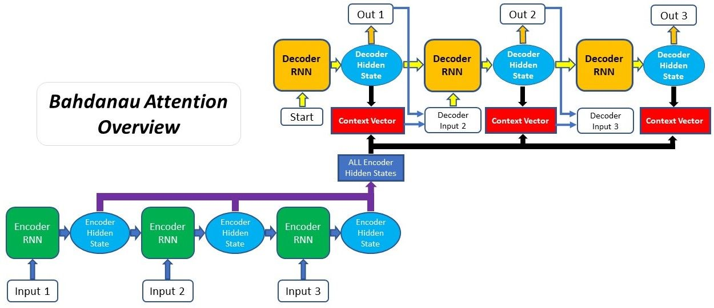

---
## Le vecteur de contexte

Dans le cas de la traduction automatique, le modèle est capable de réaligner les deux séquences, mais aussi de rapprocher _la_ de _area_ (utile pour choisir le genre vers le français).

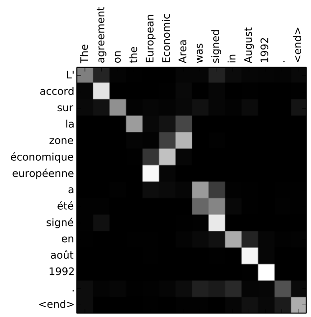

[comment]: <> (https://lbourdois.github.io/blog/nlp/Seq2seq-et-attention/)