<style>
img[alt~="center"] {
  display: block;
  margin: 0 auto;
}
h1 {
  font-size: 46px;
  color: darkred;
}
h2 {
  font-size: 38px;
  color: darkred;
}
</style>

Introduction à la philologie computationnelle

# L'analyse de mise en page

Simon Gabay

<a rel="license" href="http://creativecommons.org/licenses/by/4.0/"></a>


---
## Analyse de mise en page

L'analyse de mise en page est une tâche de vision par ordinateur (_computer vision_).

L'idée est de s'intéresser à la "mise en texte", c'est-à-dire ce qui "dans le livre n’est ni texte ni écriture, mais sans lequel ni l’un ni l’autre ne pourraient exister".

---

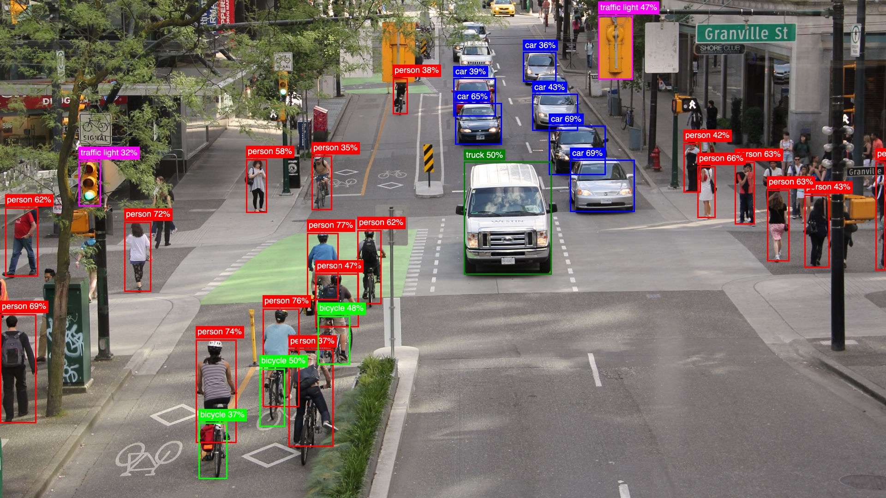

Analyse avec YOLO.

---

## Machine readable

In recent years, scholars have created the tools to retrieve information, mainly the text from (historical) documents.

By doing so, they create **machine readable** data: rather than pixels on an image, they have characters in a text document.

---

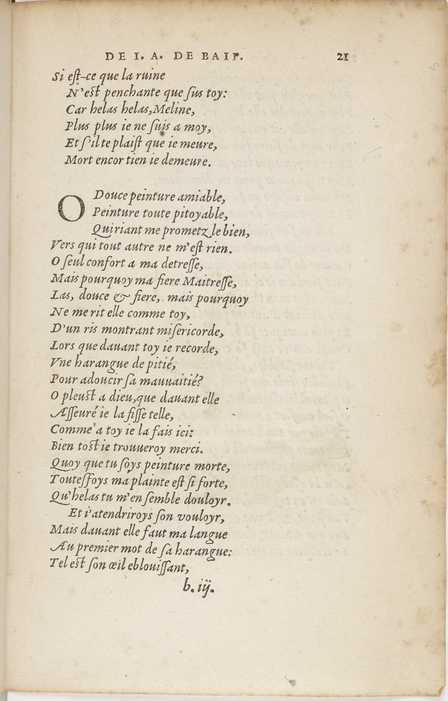

---

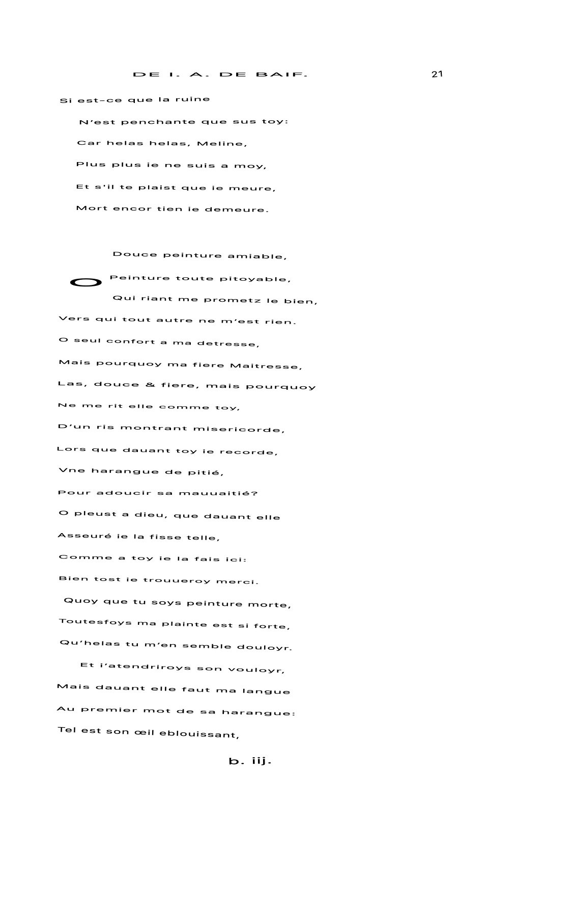

---
```
DE I. A. DE BAIF.
21
Si est-ce que la ruine
N'est penchante que sus toy:
Car helas helas, Meline,
Plus plus ie ne suis a moy,
Et s'il te plaist que ie meure,
Mort encor tien ie demeure.
O Douce peinture amiable,
Peinture toute pitoyable,
Qui riant me prometz le bien,
Vers qui tout autre ne m'est rien.
O seul confort a ma detresse,
Mais pourquoy ma fiere Maitresse,
Las, douce & fiere, mais pourquoy
Ne me rit elle comme toy,
D'un ris montrant misericorde,
Lors que dauant toy ie recorde,
Vne harangue de pitié,
Pour adoucir sa mauuaitié?
O pleust a dieu, que dauant elle
Asseuré ie la fisse telle,
Comme a toy ie la fais ici:
Bien tost ie trouueroy merci.
Quoy que tu soys peinture morte,
Toutesfoys ma plainte est si forte,
Qu'helas tu m'en semble douloyr.
Et i'atendriroys son vouloyr,
Mais dauant elle faut ma langue
Au premier mot de sa harangue:
Tel est son œil eblouissant,
b. iij.
```
---
## Machine actionable
What we now need to do is not only to retrieve the text, but to \textbf{restructure} the whole document.

By doing so, we create **machine actionable** document: rather than raw text, we have semantic labels regarding the type of text (the footnote vs the main body)

---


---

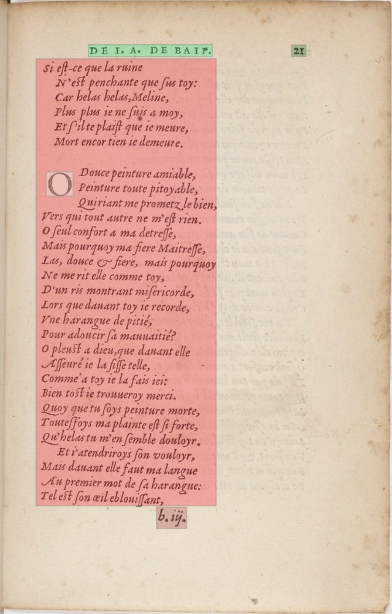

---
```xml
<pb facs="btv1b8608299v_page_00027.xml"/>
<fw>DE I. A. DE BAIF.</fw>
<fw>21</fw>
<ab>
    <lb/>Si est-ce que la ruine
    <lb/>N'est penchante que sus toy:
    <lb/>Car helas helas, Meline,
    <lb/>Plus plus ie ne suis a moy,
    <lb/>Et s'il te plaist que ie meure,
    <lb/>Mort encor tien ie demeure.
    <lb/><hi>O</hi>Douce peinture amiable,
    <lb/>Peinture toute pitoyable,
    <lb/>Qui riant me prometz le bien,
    <lb/>Vers qui tout autre ne m'est rien.
    <lb/>O seul confort a ma detresse,
    <lb/>Mais pourquoy ma fiere Maitresse,
    <lb/>Las, douce &amp; fiere, mais pourquoy
    <lb/>Ne me rit elle comme toy,
    <lb/>D'un ris montrant misericorde,
    <lb/>Lors que dauant toy ie recorde,
    <lb/>Vne harangue de pitié,
    <lb/>Pour adoucir sa mauuaitié?
    <lb/>O pleust a dieu, que dauant elle
    <lb/>Asseuré ie la fisse telle,
    <lb/>Comme a toy ie la fais ici:
    <lb/>Bien tost ie trouueroy merci.
    <lb/>Quoy que tu soys peinture morte,
    <lb/>Toutesfoys ma plainte est si forte,
    <lb/>Qu'helas tu m'en semble douloyr.
    <lb/>Et i'atendriroys son vouloyr,
    <lb/>Mais dauant elle faut ma langue
    <lb/>Au premier mot de sa harangue:
    <lb/>Tel est son œil eblouissant,
</ab>
<gb>b. iij</gb>
```
---
# Pré-éditorialisation

**Editorialisation**: processus consistant à enrôler des ressources pour les intégrer dans une nouvelle publication.

**Pré-éditorialisation**: un état numérique pivot du texte, compris comme un dénominateur commun à un maximum de projets, anticipant une série de manipulations chronophages, et qu’il est possible de continuer à enrichir sans avoir rien à y retrancher.

---


# _Pre-processing_

---

## Rotation

| Original 									  | Résultat							   |
|---------------------------------------------|----------------------------------------|
| 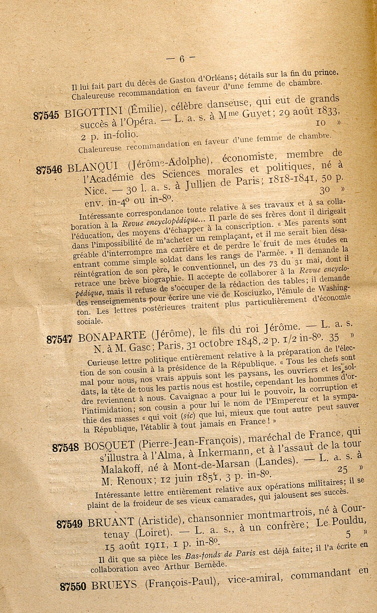 | 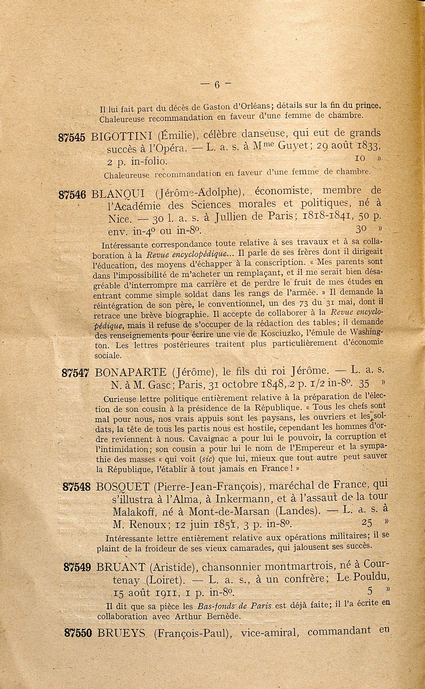|

---
## Niveau de gris

| Original 								| Résultat							   		|
|---------------------------------------|-------------------------------------------|
|  | 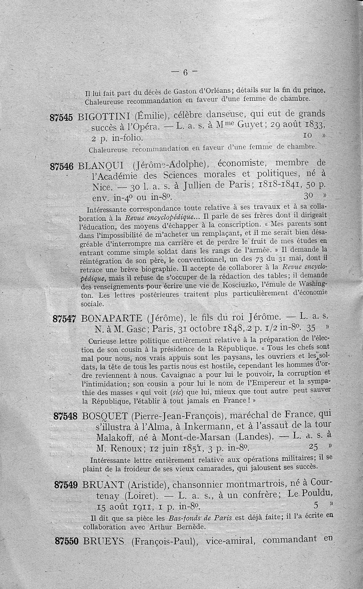|

---
## Binarisation

| Original 									 | Résultat							   		|
|--------------------------------------------|------------------------------------------|
|  | 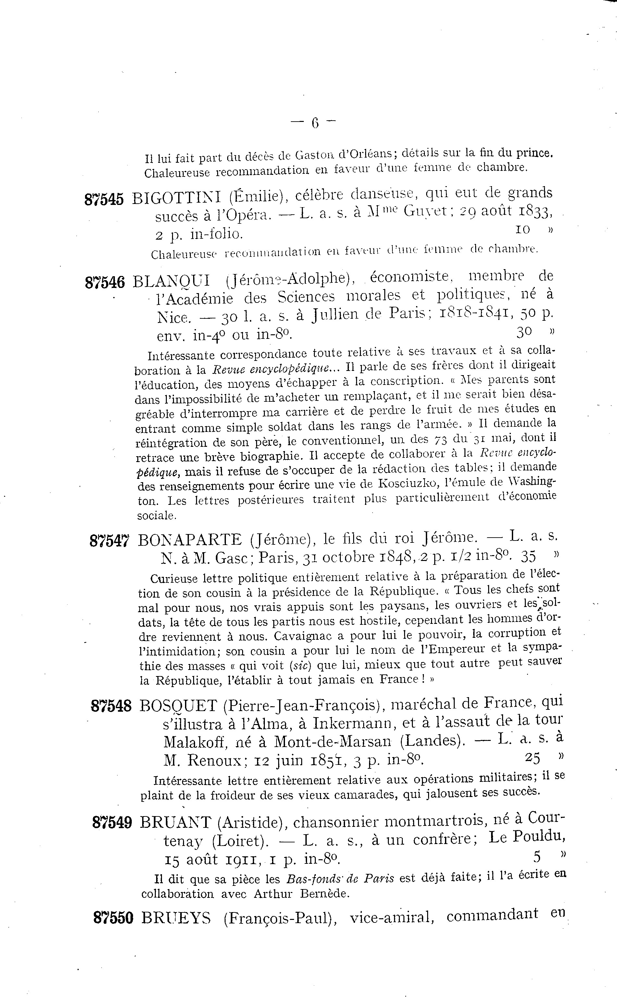|

---
## Binarisations
Le principe de la binarisation d'une image esrt de déterminer un seuil: les pixels dont le niveau de gris est en dessous du seuil deviennent noirs, et ceux au dessus deviennent blanc.

On n'utilise plus de seuil global (i.e. pour la page) mais par exemple des seuils contextuels calculés à partir de la moyenne et de la cote z d'une fenêtre centrée sur le pixel. Il existe une multitude de techniques plus ou moins efficaces comme Niblack ou son amélioration par Sauvola (cf. image).

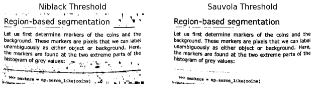


---
## Segmentation I

| Original 									| Résultat							   		   |
|-------------------------------------------|----------------------------------------------|
|  | 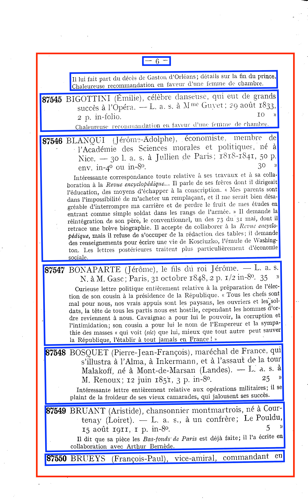|

---
## Segmentation: mise en page

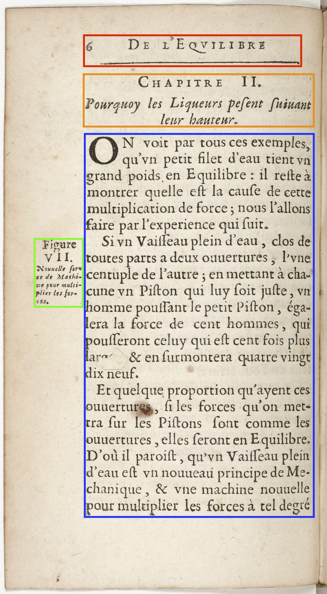

---
## Segmentation: lignes

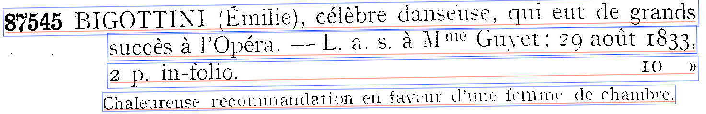

L'OCR fonctionnant au niveau des lignes, il est fondamental de les extraire au mieux. L'utilisation d'outil dédié à la segmentation, et non d'un segmenteur intégré à l'OCR, peut être intéressant

---
## Segmentation: la décoration

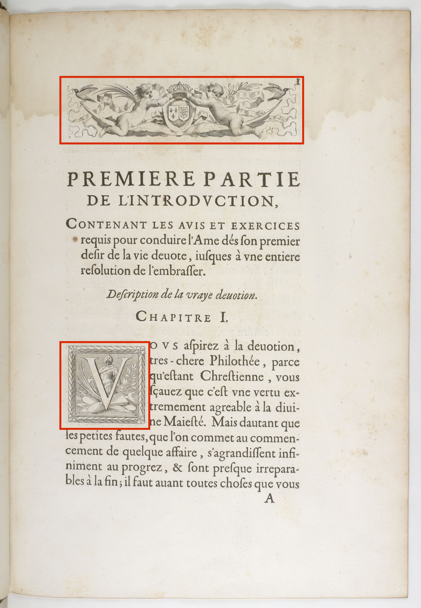

Le segmenteur peut extraire plus que des lignes: il peut extraire, par exemple, des ornements (bandeaux, initiales, culs-de-lampe…)


---

# Exercice de modélisation

---
## Analyser une image

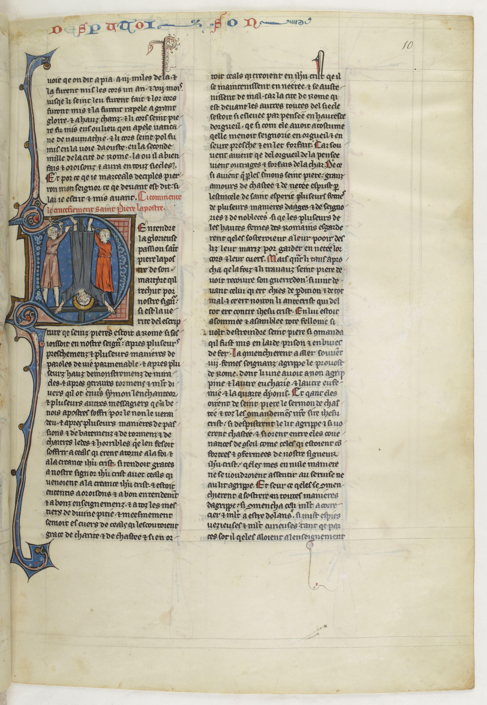

---
## Analyser une image

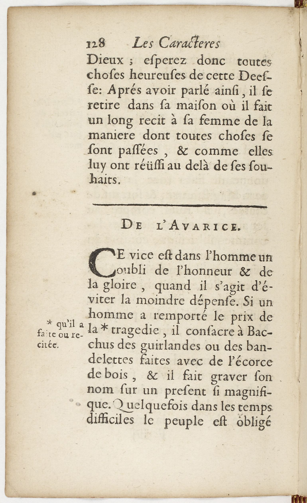

---
## Cas problématique

   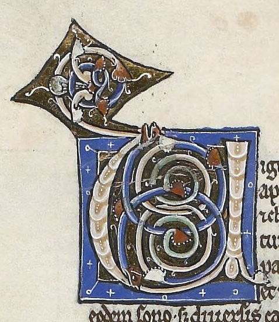

Est-ce que
- Une vignette
- Une initiale historiée
- Une initiale ornée
sont une, deux ou trois choses différentes?

---
## Cas problématique II

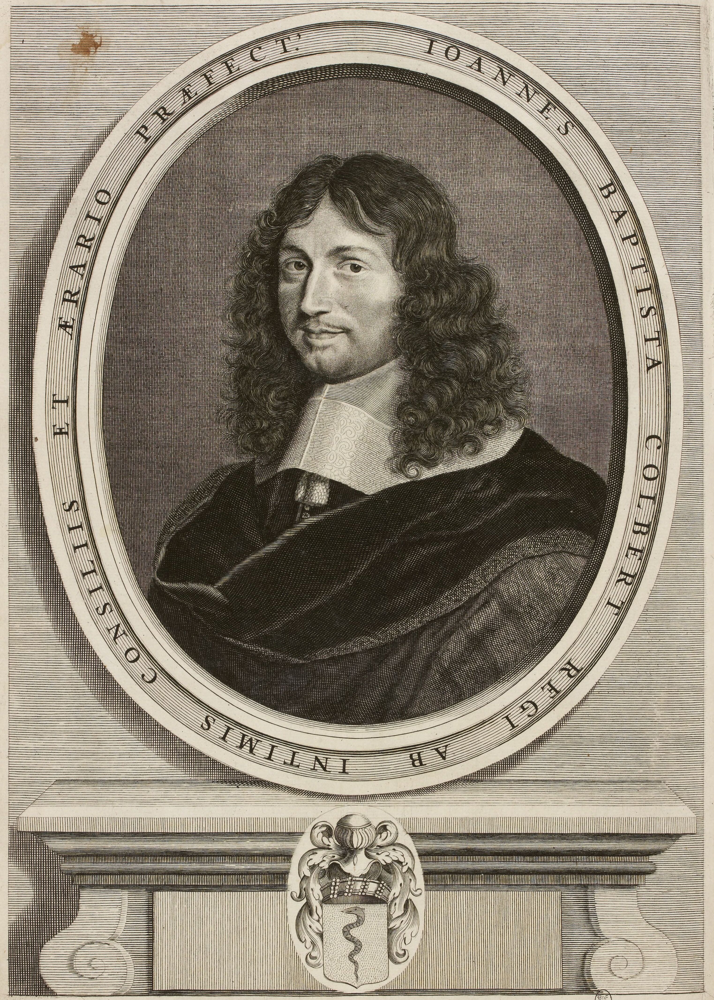 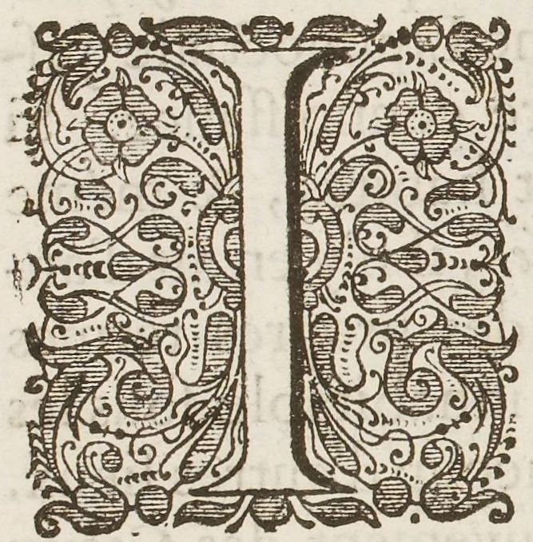  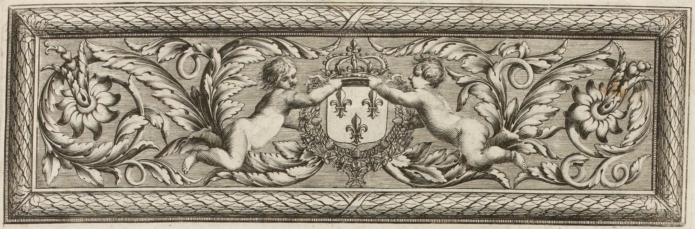 

---
## Cas limite

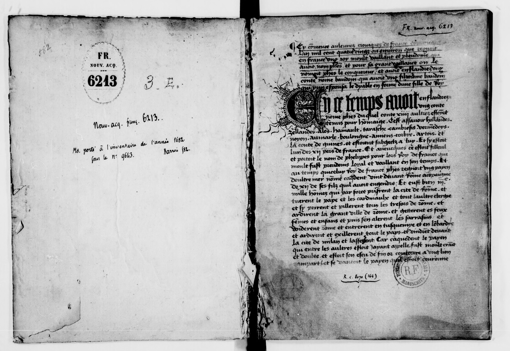

---
## Exercice

Regardez le dossier `Exercices` et tenter de trouver un dénominateur commun à toutes ces images

---

# SegmOnto

---
## Analyser une image


---
## Intuition

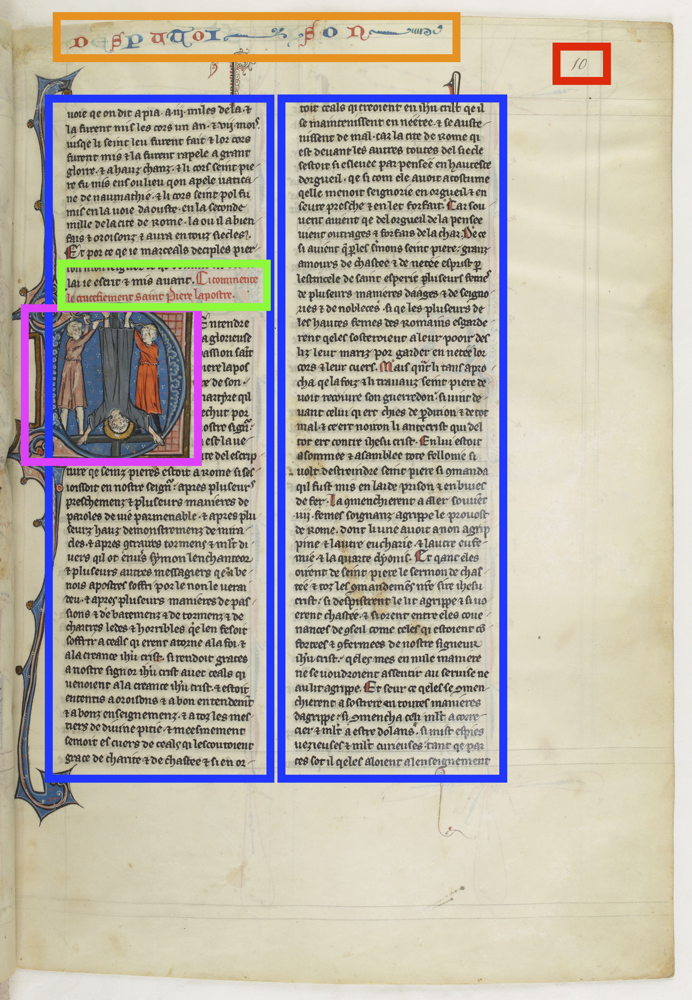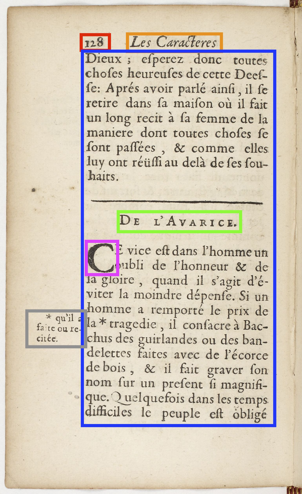

---
## Principes


Titre courant, numéro de page, corps du texte, initiale, rubrique...

Approche générale plutôt que spécifique

Mise en page plutôt qu’analyse sémantique

Une standardisation est cruciale pour la numérisation massive des documents qui s’annonce

---
## Double objectif

- Partager les données (_upstream_): l’intelligence artificielle a besoin de données: les équipes de recherche ont besoin de partager des documents annotés pour améliorer les résultats de l’HTR en augmentant la quantité de données d’entraînement
- Partager les données (_downstream_): les équipes de recherche ont aussi besoin de mettre en commun des post-traitement de données pour l’exploration des corpus et la production/transformation automatisée de documents (TEI, RDF...)

<span style="color:red;">→ Trouver un vocabulaire partagé et contrôlé pour décrire la page</span>

---
## Trouver un vocabulaire

Plutôt de créer un vocabulaire, il est préférable de s’appuyer sur de l’existant
- Vocabulaire PAGE xml, avec très peu de catégories
- Vocabulaire _Codicologia_, un vocabulaire multilingue pour la description des manuscrits, avec énormément de catégories, et adapté pour le RDF (Vocabulaire international de la codicologie - SKOS)

Liens:
- http://codicologia.irht.cnrs.fr/
- http://gams.uni-graz.at/archive/objects/o:voccod/methods/sdef:SKOS/get

---
## Modéliser
- Tenir compte des limites posées par la machine (nombre de classes, quantité de données nécessaires pour détecter une nouvelle classe)
- Être capable de trouver des dénominateur commun en jouant sur la granularité:
  - Trop peu de classes, et l'on ne récupère pas assez d'information
  - Trop de classes et on risque des chevauchement des classes

---

<style scoped>
table {
    height: 100%;
    width: 100%;
    font-size: 27px;
}
</style>

## Zones

| Zones                      | Zones (suite)             |
|----------------------------|---------------------------|
| `CustomZone`               | `NumberingZone`           |
| `DamageZone`               | `QuireMarksZone`          |
| `DigitizationArtefactZone` | `RunningTitleZone`        |
| `DropCapitalZone`          | `SealZone`                |
| `GraphicZone`              | `StampZone`               |
| `MainZone`                 | `TableZone`               |
| `MarginTextZone`           | `TitlePageZone`           |
| `MusicZone`                |                           |


---
## Lignes

- `CustomLine`
- `DefaultLine`
- `DropCapitalLine`
- `HeadingLine`
- `InterlinearLine`
- `MusicLine`

---

# Les Zones

---

<style scoped>
table {
    height: 100%;
    width: 100%;
    font-size: 20px;
    margin-bottom: -10px;
    padding-bottom: -10px;
}
div.twocols {
  margin-top: 35px;
  column-count: 2;
}
div.twocols p:first-child,
div.twocols h1:first-child,
div.twocols h2:first-child,
div.twocols ul:first-child,
div.twocols ul li:first-child,
div.twocols ul li p:first-child {
  margin-top: 0 !important;
}
div.twocols p.break {
  break-before: column;
  margin-top: 0;
}
</style>
<div class="twocols">

## `CustomZone`
- Definition: characterises any kind of zone not fitting in the other categories, according to any convenient typology the user chooses.
- Subtypes: Any
- Examples: encoding catalogue entries with
  - `CustomZone:entry#1`
  - `CustomZone:entry#2`

<p class="break"></p>

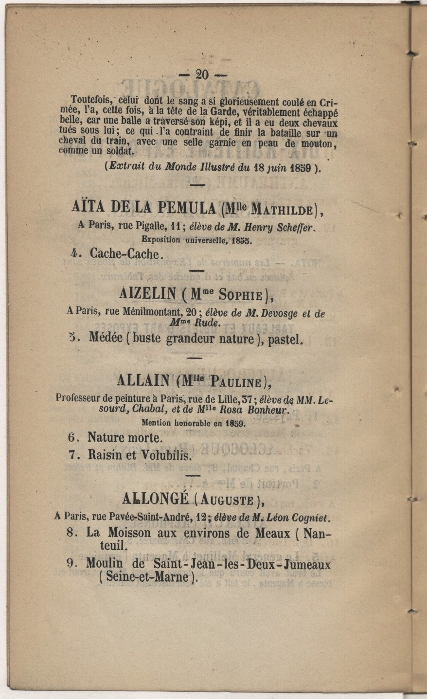
</div>

---

## `DamageZone`

* Definition: characterises any area containing damage to the source, such as holes in the material (parchment, paper…), blots, etc.
* Subtypes: suggested values include:
  * `DamageZone:corrosion` (_corrosion_)
  * `DamageZone:hole` (_trou_)
  * `DamageZone:mold` (_moisissure_)
  * `DamageZone:peeled` (_desquamé_)
  * `DamageZone:soaked` (_détrempé_)
  * `DamageZone:scuffed` (_eraillé_)
…

---
## `DamageZone` 2
Examples:

| `DamageZone:soaked` 									| `DamageZone:hole`							   		   |
|-------------------------------------------|----------------------------------------------|
| 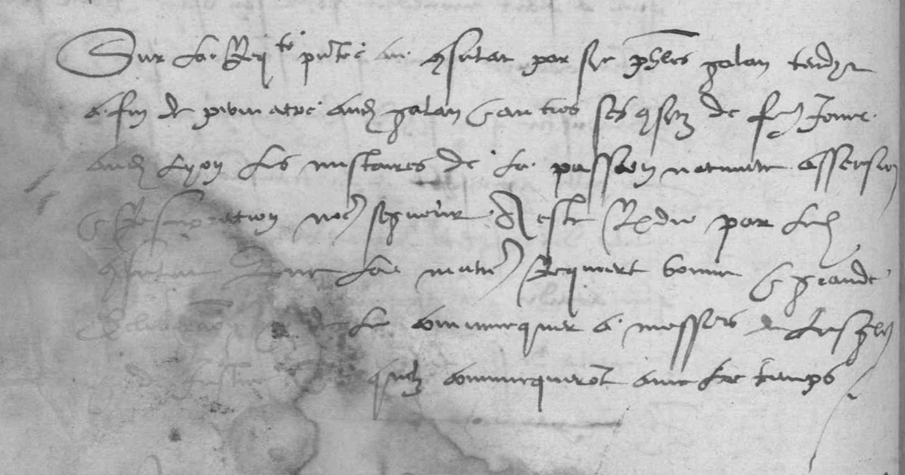 | 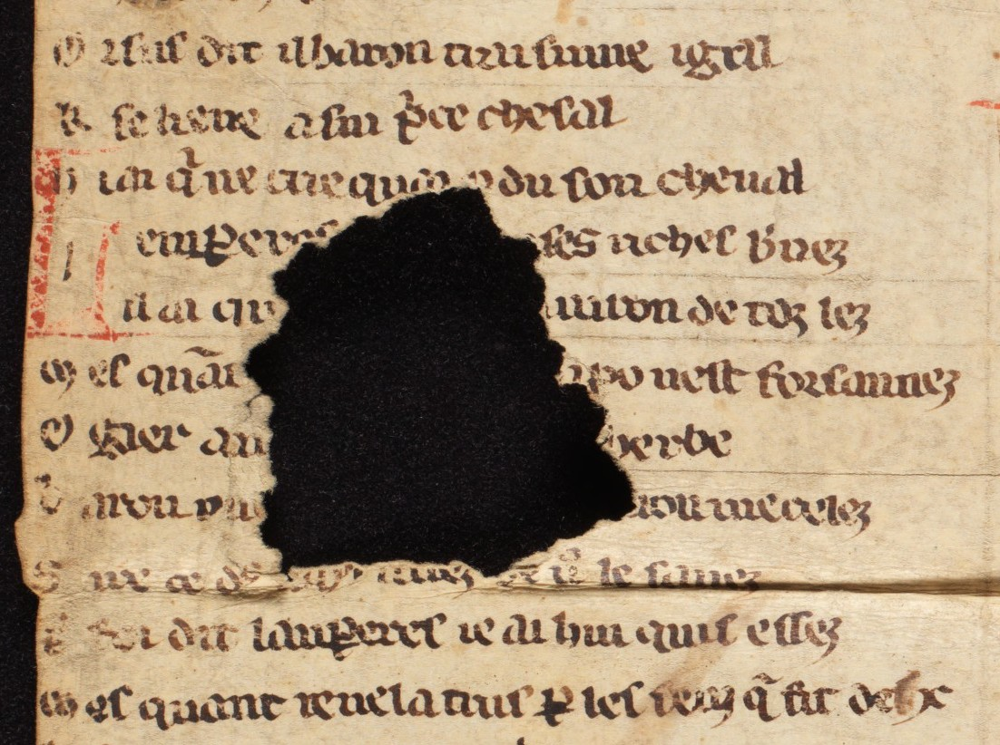|


Identifying damaged area might prove useful, as they can affect the result of text prediction.

---

## `DigitizationArtefactZone`

* Definition: it contains any type of item external to the document itself, but due to the process of digitisation, such as rulers or color tables added to help analyse the image.
* Subtypes: suggested values include:

| `DigitizationArtefactZone:testCard` 									| `DigitizationArtefactZone:ruler`							   		   |
|-------------------------------------------|----------------------------------------------|
| 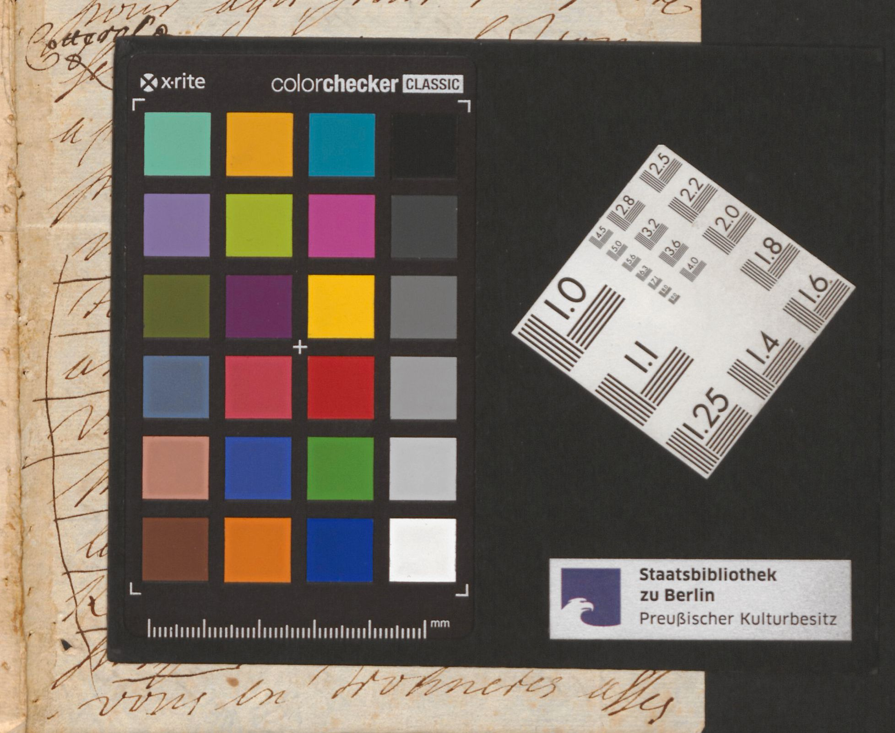 | 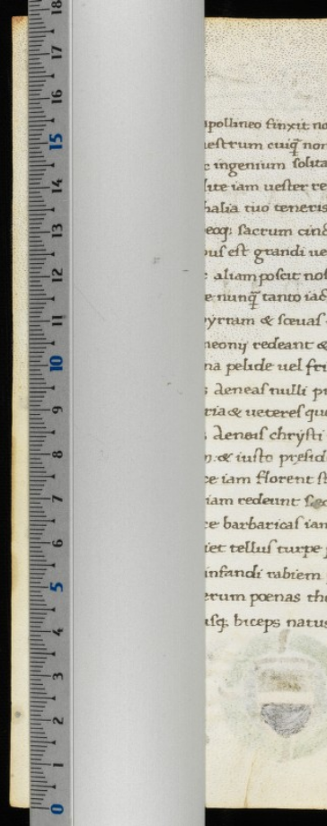|


---

## `DropCapitalZone`

* Definition: contains any type of initial letter, occupying a space corresponding to several lines of the main text or bearing significant ornementation, be they historiated, ornated, flourished or painted initials (and excluding the following text line).

* Subtypes: suggested values include:

  * `DropCapitalZone:historiated`
  * `DropCapitalZone:floriate`
  * `DropCapitalZone:flourish`
  * `DropCapitalZone:voided`
  * `DropCapitalZone:parted`

---

## `DropCapitalZone`

  * `DropCapitalZone:champ`
  * `DropCapitalZone:facetted`
  * `DropCapitalZone:plain`
  * `DropCapitalZone:interlocked`

| Initiale manuscrite 									| initiale imprimée							   		   |
|-------------------------------------------|----------------------------------------------|
| 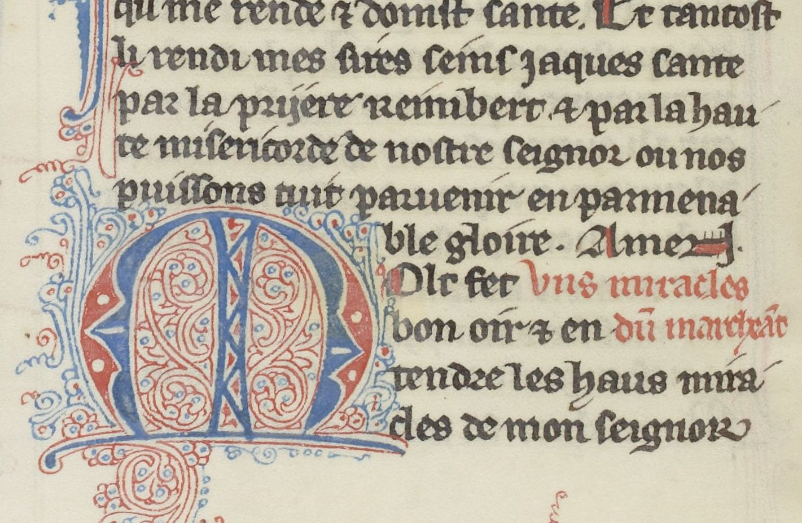 | 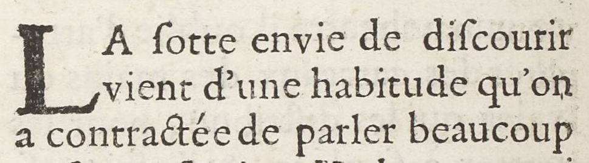|


---

## `GraphicZone`

* Definition: characterises a zone containing any type of graphic element, from purely ornamental  to consubstantial to the text (e.g., full page paintings, line-fillers, marginal drawings, figures, etc.).
* Subtypes: suggested values include:

  * `GraphicZone:illustration`
  * `GraphicZone:ornamentation`
  * `GraphicZone:figure`

---
## `GraphicZone`

| `GraphicZone:illustration` 								| `GraphicZone:ornamentation`							   		   |
|-------------------------------------------|----------------------------------------------|
|  | 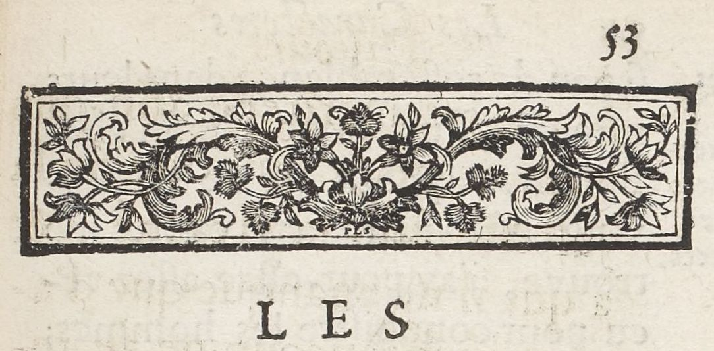 |


| `GraphicZone:figure` 									    | `GraphicZone:figure`							   		   |
|-------------------------------------------|----------------------------------------------|
| 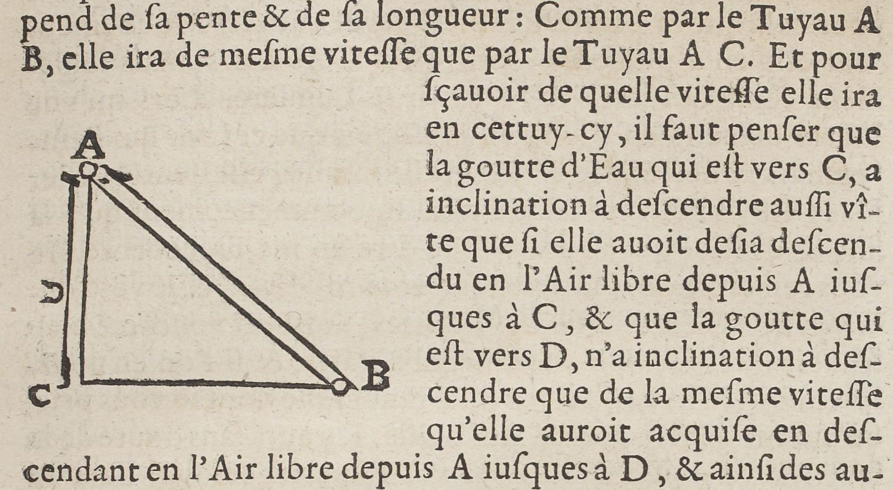 | 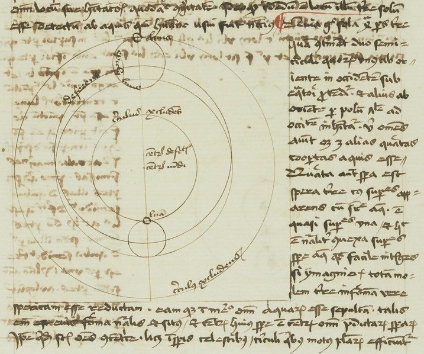 |

---

## `MainZone`

* Definition the main area (text column) designed to contain text, either as a single  or several columns (as designed in the conception of the layout: including eventually text, music notations, illumination, etc.).

* Subtypes: suggested values include:

| `MainZone:column` 								| `MainZone:column#1` and `MainZone:column#1`							   		   |
|-------------------------------------------|----------------------------------------------|
| 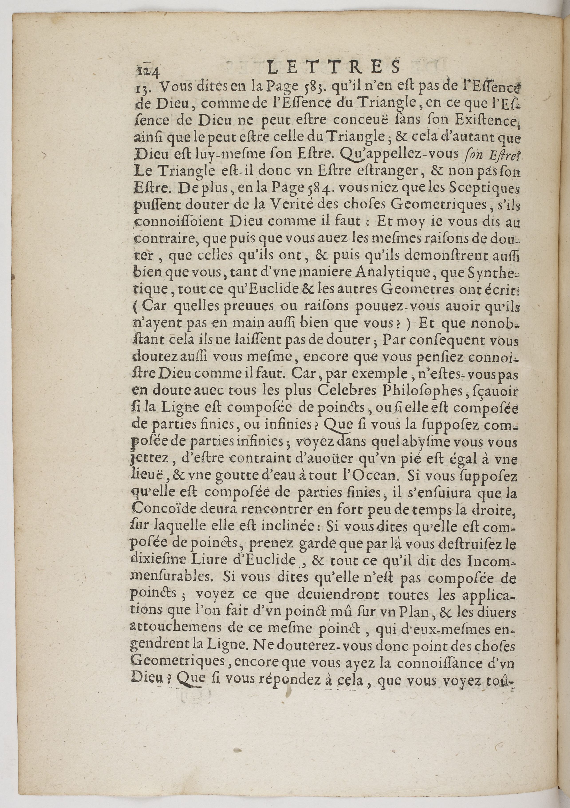 | 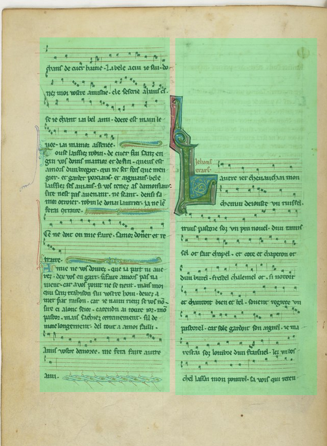 |


---

## `MarginTextZone`

* Definition: characterises any **text zone** contained in the margins (upper, lower, inner or outer), including the space between two columns, whatever their semantic status (gloss, additions, …).

* Subtypes: suggested values include:

  * `MarginTextZone:note`
  * `MarginTextZone:commentary`
  * `MarginTextZone:correction`
  * `MarginTextZone:variants`

---
## `MarginTextZone`

| `MarginTextZone` 								          | .                 							   		   |
|-------------------------------------------|------------------------------------------|
| 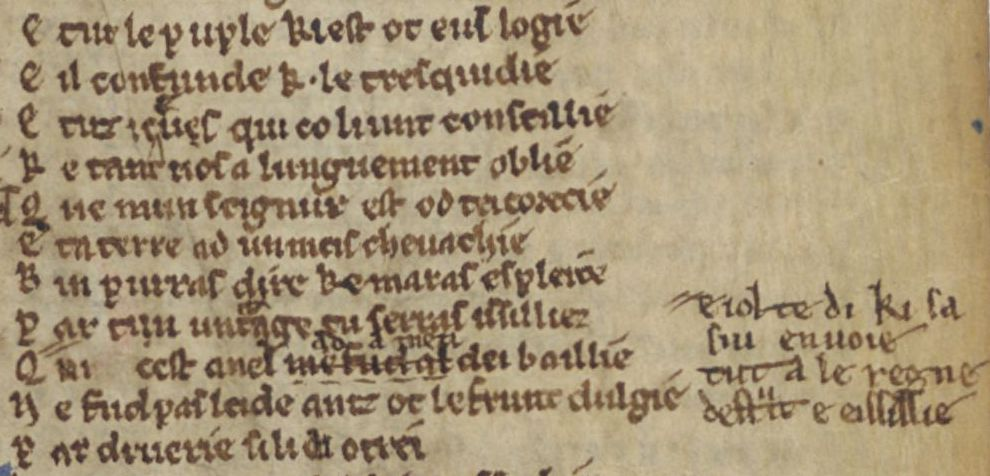 | 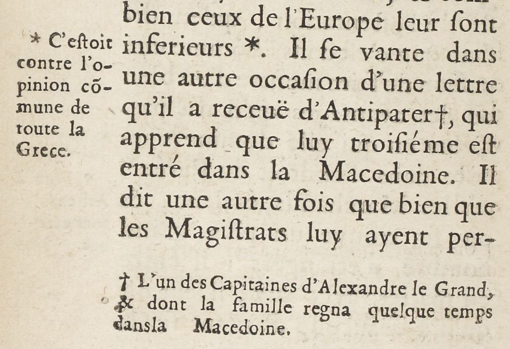 |

| `MarginTextZone:variantes` 			            | `MarginTextZone:variantes`			   		      |
|---------------------------------------------|---------------------------------------------|
| 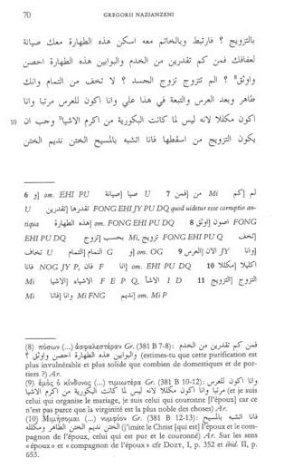 |  |

---

## `MusicZone`

* Definition: characterises an area containing musical notations, such as neumes, staves, etc., with the possible inclusions of text.

* Subtypes: none

* Examples:

| `MusicZone` imprimée 			                  | `MusicZone` manuscrite    			   		      |
|---------------------------------------------|---------------------------------------------|
| 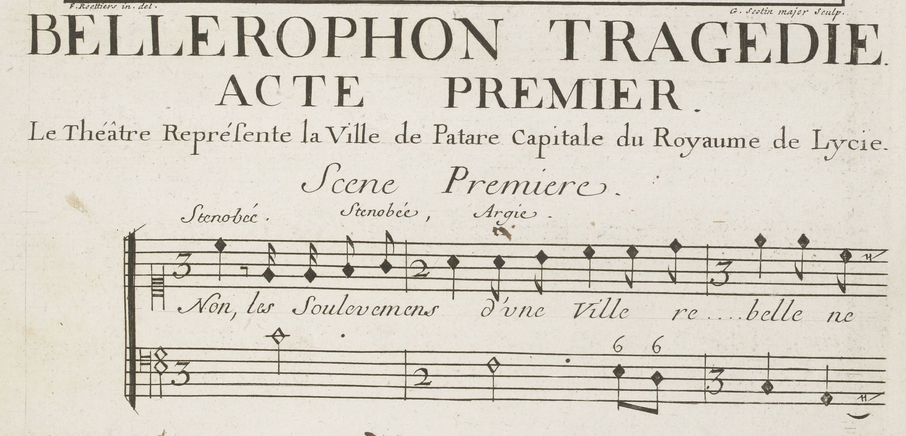    | 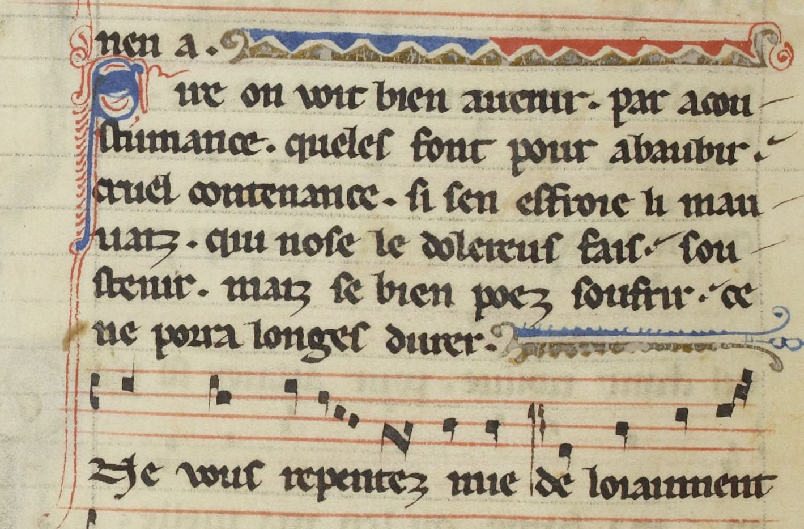    |


---

## `NumberingZone`

* Definitio: it characterises a zone containing the page number.

* Subtypes: suggested values include:
  * `NumberingZone:page`
  * `NumberingZone:other`

* Examples

| `NumberingZone:folio`             		      | `NumberingZone:page`    	    		   		    |
|---------------------------------------------|---------------------------------------------|
| 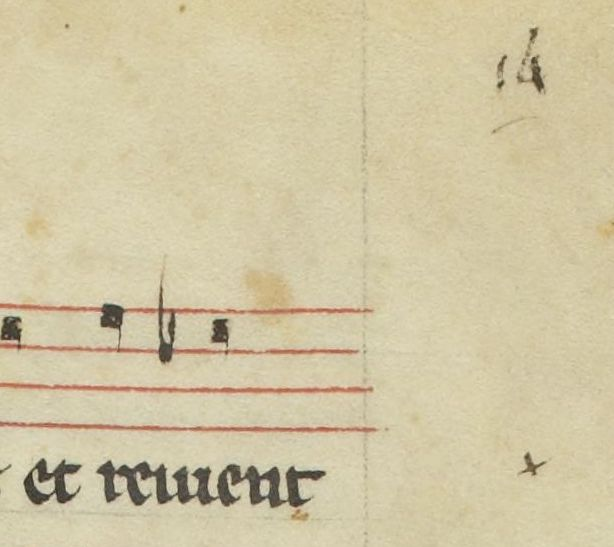    | 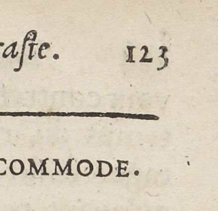 |


---
## `QuireMarksZone`

* Definition: characterises a zone containing a quire signature (i.e., _a ii_), catchword, or any kind of element relative to the material organisation of the source, with the exclusion of page numbers.

* Subtypes: suggested values include:
  * `QuireMarksZone:signature`
  * `QuireMarksZone:catchwords`

---
## `QuireMarksZone`
* Examples
  * `QuireMarksZone:signature`

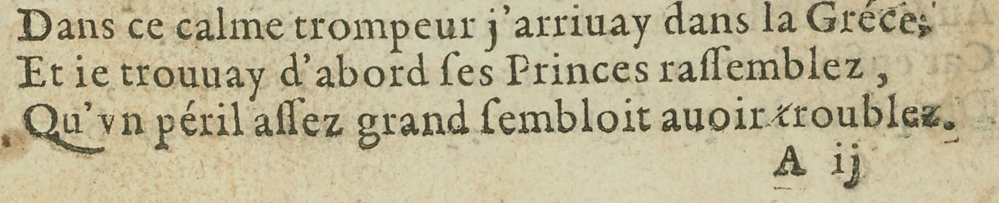

  * `QuireMarksZone:catchwords`

| `QuireMarksZone` manuscrite            		  | `QuireMarksZone` imprimée   	   		     |
|---------------------------------------------|------------------------------------------|
| 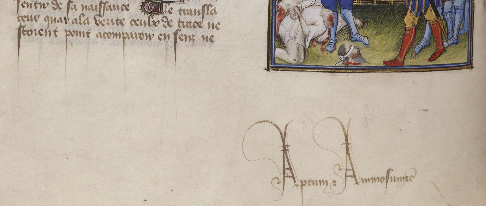   | 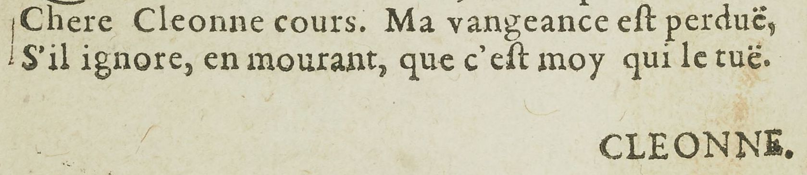 |


---

## `RunningTitleZone`

* Definition: characterises a zone containing a running title.

* Subtypes: none

* Examples

| `RunningTitleZone` imprimée            	  | `RunningTitleZone` manuscrite   	   	    |
|-------------------------------------------|-------------------------------------------|
| 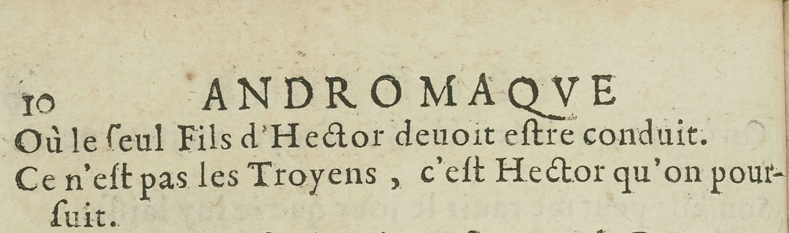  | 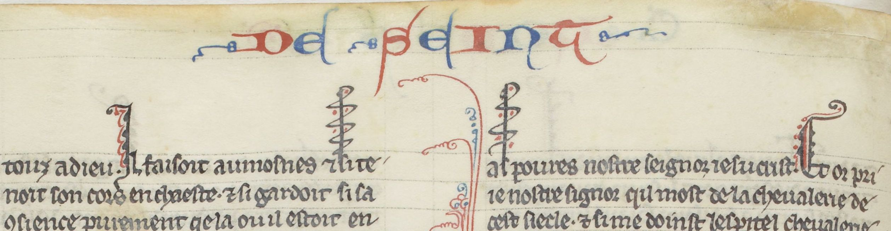 |


---

## `SealZone`

* Definition: it characterises a zone containing a seal.

* Subtypes: none

* Examples

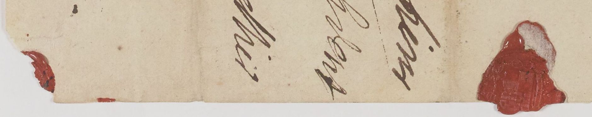


---

## `StampZone`

* Definition: it characterises a zone containing a stamp, be it a library stamp or a mark from a postal service.

* Subtypes: suggested values include:
  * `StampZone:postal`
  * `StampZone:curatorial`

---

## `StampZone`

* Examples
  * `StampZone:curatorial`

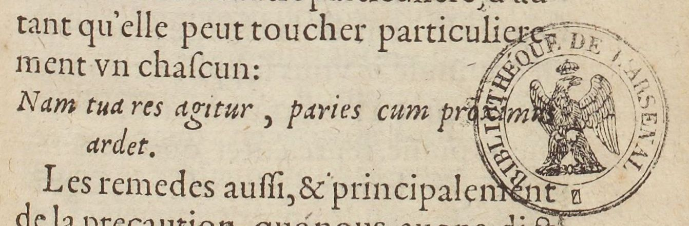
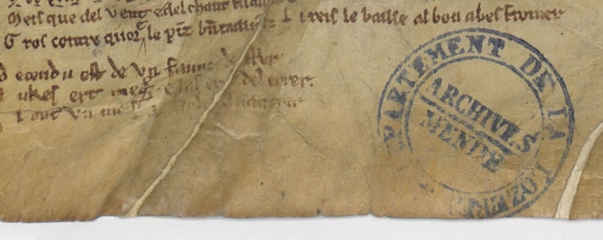

* `StampZone:postal`

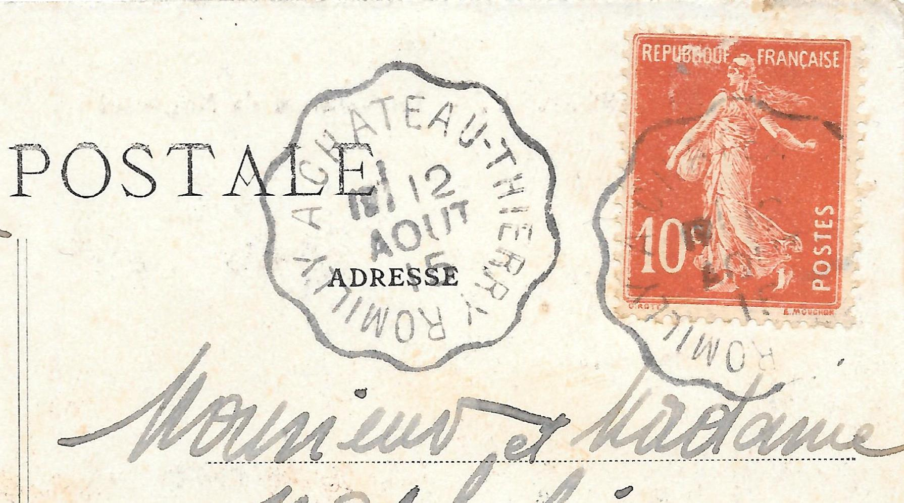

---

## `TableZone`

* Definition: characterises a zone containing a table of any kind.

* Subtypes: none

* Examples

| `TableZone`                           	  | `TableZone`                      	   	    |
|-------------------------------------------|-------------------------------------------|
|     |  |


---

## `TitlePageZone`

* Definition: it characterises a zone containing a title distinct from the main text. It is mainly used for prints.

* Subtypes: none

* Examples

| `TitlePageZone` manuscrite                | `TitlePageZone` imprimée              	  |
|-------------------------------------------|-------------------------------------------|
|     |     |

---

# Les lignes

---
## `CustomLine`

* Definition: characterises any kind of line not fitting in the other categories, according to any convenient typology the user chooses.

* Subtypes: Any

* Justification: all projects have specific needs regarding types of lines peculiar to their sources or their goals and  not covered by the standard types.

---
## `DefaultLine`

* Definition: it characterises any kind of standard text line, whether they are included in the `MainZone` text, in the `MarginZone`, in `MusicZone`, or in any type of zone.

* Subtypes: none

* Examples

| `DefaultLine` imprimée                    | `DefaultLine` manuscrite              	  |
|-------------------------------------------|-------------------------------------------|
|  |   |

---
## `DropCapitalLine`

* Definition: characterises a line on which rests a [`DropCapital`](https://github.com/SegmOnto/examples/tree/main/zones/DropCapital).

* Subtypes: none

* Examples

| `DefaultLine` imprimée                    | `DefaultLine` manuscrite              	  |
|-------------------------------------------|-------------------------------------------|
|  |   |

* Justification: drop capitals are both specific zones, and bear a text.

---
## `InterlinearLine`

* . Definition: characterises a line that is not a standard text line, but as been added between two of them, for instance to include a forgotten word.

* Subtypes: suggested values include:

  - `InterlinearLine:commentary`
  - `InterlinearLine:correction`

* Examples

  - `InterlinearLine:correction`


---
## `MusicLine`

* Definition: caracterises the central line of a musical stave.

* Subtypes: none

* Examples


* Justification: analysis or prediction of musical content can be as necessary as the text's.

---
## `HeadingLine`

* Definition: characterises a line containing a rubric, for instance signalling the beginning of a new text.

* Subtypes: suggested values include:

  - `HeadingLine:incipit`
  - `HeadingLine:explicit`
  - `HeadingLine:title`

* Examples
 

---

# Extensions

---
## Le manuscrit moderne


---
## LaDaS

 
