<style>
img[alt~="center"] {
  display: block;
  margin: 0 auto;
}
h1 {
  font-size: 46px;
  color: darkred;
}
h2 {
  font-size: 38px;
  color: darkred;
}

.junicode { font-family: Junicode; }
.blue { color: blue; }
.red { color: red; }
.ora { color: orange; }

</style>

Introduction à la philologie computationnelle

# Transcrire (automatiquement)

Simon Gabay

<a style="float:right; width: 20%;" rel="license" href="http://creativecommons.org/licenses/by-sa/4.0/"></a>

---

# Une nouvelle philologie?

---
## Editer (avant)

Ms Cologny, Fondation bodmer, Ms. 168

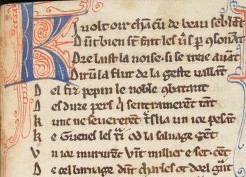
https://www.e-codices.unifr.ch/en/fmb/cb-0168/211r

---
## Editer (avant)

_Otinel, chanson de geste publiée pour la première fois, d'après les manuscrits de Rome et de Middlehill_, éd. F. Guessard et H. Michelant, Paris: Jannet, 1859

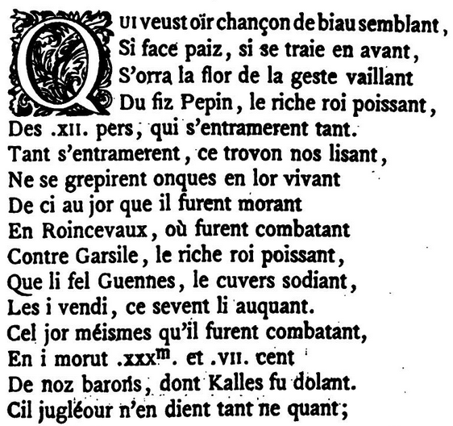
https://archive.org/details/floovantchanson00floogoog

---
## Editer (maintenant)

Camps, Jean-Baptiste, _La Chanson d'Otinel. Édition complète du corpus manuscrit et prolégomènes à l'édition critique_, Paris:Université de Paris-Sorbonne, 2016


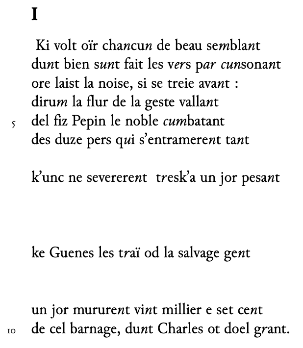
https://halshs.archives-ouvertes.fr/tel-01664932

---
## Editer (maintenant)

Camps, Jean-Baptiste, _La Chanson d'Otinel. Édition complète du corpus manuscrit et prolégomènes à l'édition critique_, Paris:Université de Paris-Sorbonne, 2016

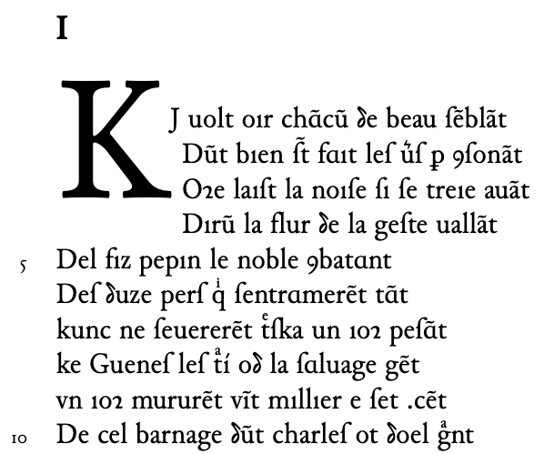
https://halshs.archives-ouvertes.fr/tel-01664932

---
## Niveaux de transcription

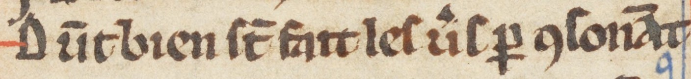

Transcription allographétique:

<span style="font-family:Junicode">Dūt bien ſt̄ faıt  leſ ủſ ꝑ ſonāt</span>

Transcription graphématique:

<span style="font-family:Junicode">Du<i>n</i>t bien s<i>un</i>t fait les v<i>er</i>s p<i>ar</i> <i>cun</i>sona<i>n</i>t</span>

Transcription modernisée:

<span style="font-family:Junicode">Dont bien sont fait les vers par consonant</span>

---
## Terminologie

Robinson et Solopova, "Guidelines for Transcription of the Manuscripts of the Wife of Bath’s Prologue", _The Canterbury Tales Project Occasional Papers 1_, 1993
- "Regularized": _all manuscript spellings are regularized to a particular norm_
- "Graphemic": _every manuscript spelling is preserved_
- "Graphetic": _every distinct letter-type is distinguished_
- "Graphic": _every mark in the manuscript, every space, is represented in the transcription, even to the point of decomposition of letter forms into discrete marks_

---
## Terminologie: précisions

Dominique Stutzmann, "Paléographie statistique pour décrire, identifier, dater... Normaliser pour coopérer et aller plus loin ?", _Kodikologie und Paläo-graphie im digitalen Zeitalter_, 2011.

"Si encoder, c'est décrire":
- "Graphique" et "graphétique" (ou de préférence "allographétique") décrivent l'image
- "Graphémique" (ou "graphématique") décrit le texte-objet soumis aux accidents
- "Regularisé" décrit le texte-idée

---
## Transcrire

<span style="font-family:Junicode">Dūt bien ſt̄ faıt  leſ ủſ ꝑ ſonāt</span>

est encodé:

```
Dūt bien ſt̄ faıt  leſ ủſ ꝑ ſonāt
```

On note:
- des lettres unicodes normales: `t` (`U+0074`)
- un caractère combiné: `t` + `◌̄` (`U+0074`+ `U+0304`)
- une lettre du domaine privé (MUFI): <span style="font-family:Junicode"></span> (`U+F1A6`), cf. [ici](https://mufi.info/m.php?p=muficharinfo&i=4772)

Pour afficher les cactères du domaine privé, on utilise des polices spéciales, comme `Junicode`, qui intègre la MUFI (et doit être installée)

```html
<span style="font-family:Junicode">le ủſ ꝑ son</span>
```

Pour installer Junicode: https://junicode.sourceforge.io/

---
## La _Medieval Unicode Font Initiative_ (MUFI)

On a tous connu le problème suivant: _expérience_ devrait s'afficher, mais c'est _expÚrience_ qui s'affiche. C'est une problème d'unicode.

Unicode est un standard informatique qui permet des échanges de textes dans différentes langues, à un niveau mondial.

La MUFI permet d'encoder des lettres médiévales (ou plus généralement rares) absentes d'Unicode: https://mufi.info

---
## Segmenter

Thibault Clérice,"Evaluating Deep Learning Methods for Word Segmentation of Scripta Continua Texts in Old French and Latin", _Journal of Data Mining and Digital Humanities_, Episciences.org, 2020


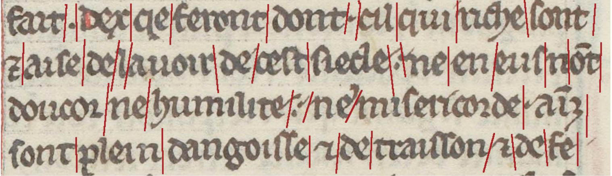

Doit-on conserver les agglutinations?
_⁊ aiſe de lauoir de ceſt ſiecle. ne en euſ nōt_

ou bien doit-on désagglutiner?

_⁊ aiſe de l'auoir de ceſt ſiecle. ne en euſ n'ōt_

---
## De nouvelles pratiques

Les possibilités de transcription n'ont jamais été aussi vastes:
- devons-nous continuer comme avant avec du semi-diplomatique, voire une transcription interprétative?
- doit-on exploiter au maximum les possibilités offertes par le numérique?
- doit-on faires les deux?

Cela dépend évidemment de plusieurs paramètres:
- mes questions de recherche
- mes compétences personnelles
- mes moyens financiers

C'est un exemple du tournant épistémologique majeur que constitue le numérique, et non une simple informatisation des pratiques anciennes

---
# Entraînement

--- 

## Création d'une vérité de terrain (_ground truth_)

Les images transcrites sont alors associées à leur transcription

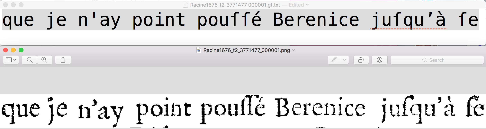

---
## Transcrire (I)
_Transkribus_ (Innsbruck)

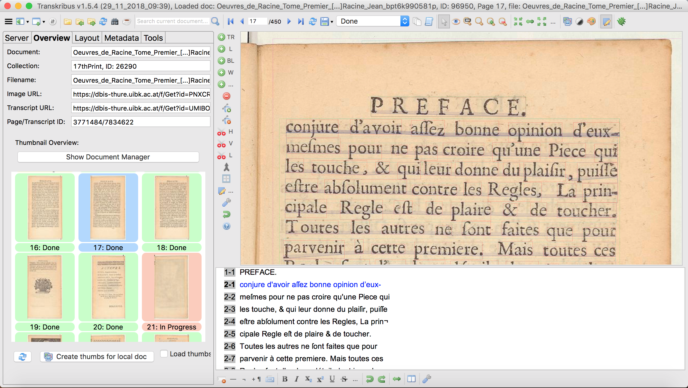


---
## Transcrire (II)
_eScriptorium_ (EPHE/PSL)

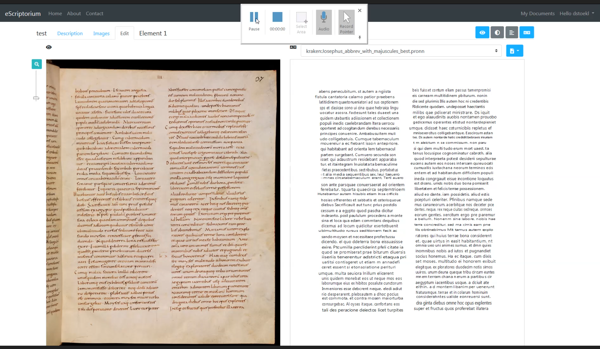

---
## Entraînement (I)

Comme c'est du _machine learning_, on va répéter l'entraînement une multitude de fois (on parle d'_epochs_, de _stages_ …). À chaque fois un modèle est créé: celui qui permforme le mieux est conservé

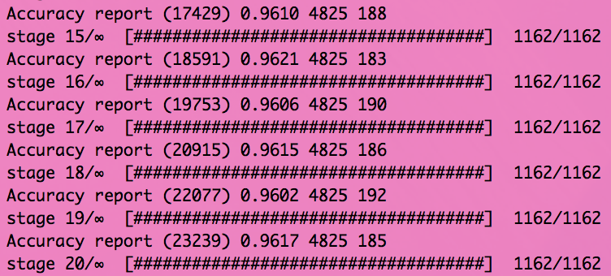

---
## Entraînement (II)

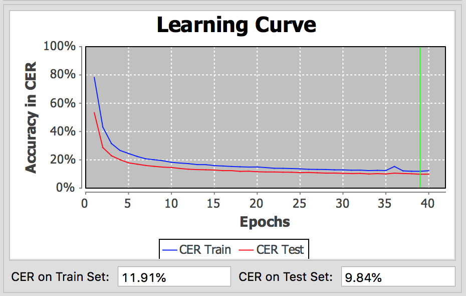

---
## Scores

* On parle de CER (_Character Error Recognition_) et parfois de WER (_Word Error Recognition_).
* Distance de Levenshtein : combien d’opérations pour retrouver le résultat attendu (par exemple entre tonte et toute )?
* <p style="color:red">Une seule lettre fausse crée un mot faux ! Le WER est donc toujours supérieur au CER !</p>
* Ces scores peuvent être calculés sur deux jeux de données :
	* Le train set (on OCRise les images qui servent pour l’entraînement)
	* Le test set (on OCRise des images qui n’ont pas servi pour l’entraînement)
---
## L'amélioration des scores: données artificielles

* Avec Baskerville


* Avec IM FELL English SC


* Avec JSL Ancient

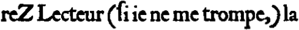

* Avec Chapbook

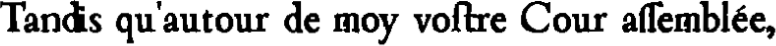


---
## L'amélioration des scores: bruit

* Original

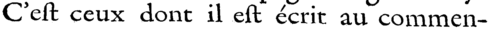

* Bruit faible

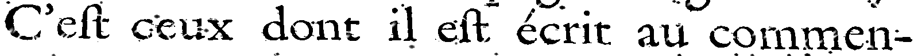

* Bruit fort

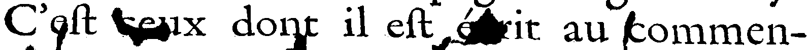


---
## L'amélioration des scores: modification du cadre

* Cadre normal


* Cadre élargi

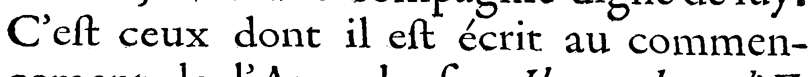

---

---
## Medieval documents

CATMuS for medieval manuscripts


_Cambrai, BM, ms 470, 8th century_

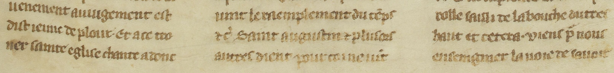
_Paris, BnF, Fr. 185, 14th century_

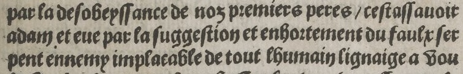
_Paris, BnF, RES-8-O2F-31, 16th century_

---
## Modern manuscripts

FoNDUE-GD for modern manuscripts

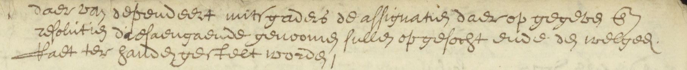
_The Hague, National Archives of the Netherlands, 17th century_

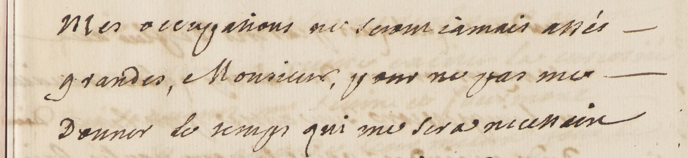
_Paris, BnF, NAF 6834, 18th century_

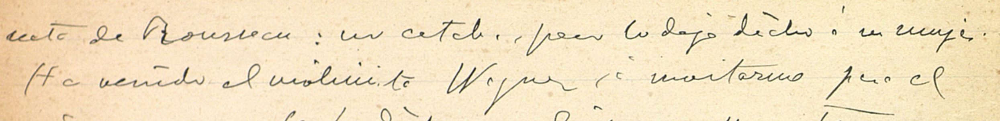
_Universitat de Lleida, R. Viñes archives, 19th century_

---
## Testing

We need to establish types to evaluate the model

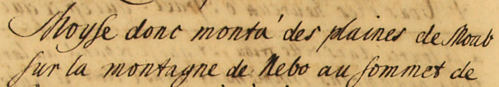
_Aschaffenburg, Hofbibliothek, Ms. 48, 18th c. bâtarde_

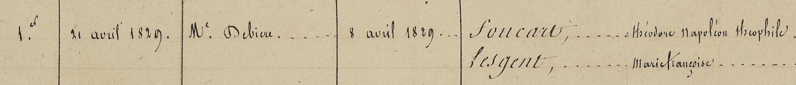
_Paris, Archives nationales, CM/1, 19th c., ronde and bâtarde_

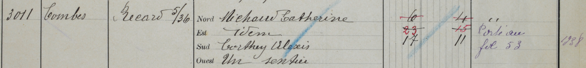
_Val de Bagnes, AC Bagnes, R 72, 19th-20th c., anglaise_

---
## ATR

<div style="display:flex; gap:2em; align-items:center;">
<div style="flex:1">

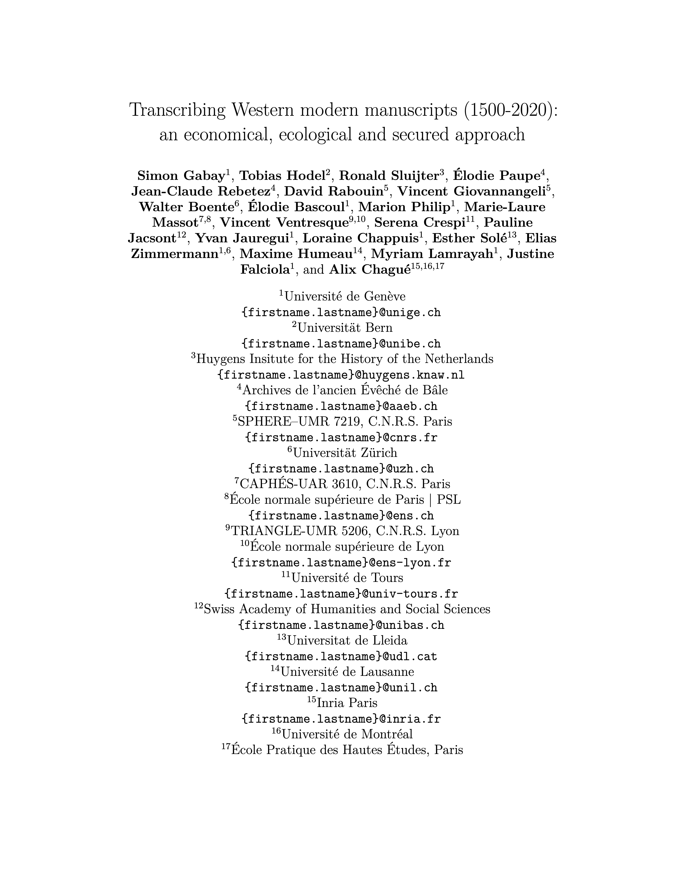

</div>
<div style="flex:1">

- We now talk of "Automatic Text Recognition" (ATR) rather than "Optical character recognition" (OCR) or "Handwritten Text Recognition" (HTR).
- Efficient models can only be produced via international collaborations

</div>
</div>

---
<style scoped>
table { font-size: 16px; }
td, th { padding: 2px 8px; }
</style>

## Aggregating training data (I)

| Project | Language | Century | Pages | Lines | available |
|---|---|---|---:|---:|---|
| [IJSBERG](https://noord-hollandsarchief.nl/ontdekken/nhalab/project-transkribus-2) | nl | 17th-18th c. | 6 275 | 259 517 | [Yes](https://zenodo.org/records/4159268) |
| [REPUBLIC](https://dl.acm.org/doi/10.1145/3575864) | nl | 17th c. | 514 | 46 690 | [Yes](https://doi.org/10.5281/zenodo.7695131) |
| **Subtotal** | | | **6 789** | **306 207** | |
| [Heinrich Wölfflin](https://hal.science/hal-04090312) | de/it | 20th c. | 1 107 | 2 290 | [Yes](https://github.com/FoNDUE-HTR/FoNDUE_Wolfflin_Fotosammlung) |
| [EditionEugenHuber](https://doi.org/10.1007/978-3-031-41498-5_3) | de | 20th c. | 1 921 | 45 194 | [No](https://github.com/pstroe/huber-htr) |
| [Swiss Federal Council](https://openhumanitiesdata.metajnl.com/articles/10.5334/johd.46) | de | 19th c. | 2 752 | 2 752 | [Yes](https://doi.org/10.5281/zenodo.4746342) |
| [Staatsarchivs Zürich](https://doi.org/10.1515/abitech-2020-2018) | de | 19th c. | 2 969 | 94 201 | No |
| Meyer von Schauensee | de | 18th c. | 242 | 9 303 | [Yes](https://github.com/FoNDUE-HTR/FONDUE-DE-MSS-18) |
| [Crimes et châtiments](https://app.transkribus.org/sites/aaeb) | de | 17th c. | 95 | 1 756 | [Yes](https://github.com/FoNDUE-HTR/FONDUE-DE-AAEB-17) |
| [Basler Urfehdebuchs X](https://app.transkribus.org/sites/aaeb) | de | 16th c. | 192 | 8 221 | [Yes](https://zenodo.org/records/5153263) |
| [Crimes et châtiments](https://app.transkribus.org/sites/aaeb) | de | 16th c. | 65 | 1 269 | [Yes](https://github.com/FoNDUE-HTR/FONDUE-DE-AAEB-16) |
| **Subtotal** | | | **9 343** | **164 986** | |
| Ricardo Viñes | sp | 20th c. | 48 | 2 168 | Soon |
| Occupation of Araucania | sp | 19th c. | 146 | 3 235 | [Partially](https://github.com/Proyecto-Ocupacion-Araucania-UChile/HTR_Araucania_XIX) |
| **Subtotal** | | | **194** | **5 403** | |
| [Philiumm](https://eman-archives.org/philiumm/) | la | 17th c. | 207 | 13 049 | [Partially](https://github.com/FoNDUE-HTR/FONDUE-LA-MSS-17-PR) |
| Sardi's Toponomasia | la | 16th c. | 51 | 2 003 | [Partially](https://github.com/PaulineJac/GasparoSardiToponomasia) |
| **Subtotal** | | | **258** | **15 052** | |

---
<style scoped>
table { font-size: 18px; }
td, th { padding: 2px 8px; }
</style>

## Aggregating training data (II)

| Project | Language | Century | Pages | Lines | available |
|---|---|---|---:|---:|---|
| [Moonshines](https://github.com/alix-tz/moonshines) | fr | 21st c. | 54 | 1 186 | [Yes](https://github.com/alix-tz/moonshines) |
| CREMMA-wikipedia | fr | 21st c. | 357 | 1 973 | [Yes](https://github.com/HTR-United/cremma-wikipedia) |
| CREMMA-MSS-20 | fr | 20th c. | 15 | 224 | [Yes](https://github.com/HTR-United/CREMMA-MSS-20) |
| Digital Peraire | fr | 20th c. | 75 | 2 569 | [Yes](https://github.com/alix-tz/peraire-ground-truth) |
| [Testaments de Poilus](https://testaments-de-poilus.huma-num.fr) | fr | 20th c. | 228 | 3 330 | [Yes](https://github.com/HTR-United/CREMMA-AN-TestamentsDePoilus) |
| [Verbier Time Machine](https://www.timemachinevs.ch/verbier-time-machine) | fr | 19th-20th c. | 192 | 28 476 | [Partially](https://github.com/VTM-Registre-foncier-de-Verbier/VTM_registre_ACBagnes_R72) |
| [Lectaurep](https://lectaurep.hypotheses.org/) (répertoires) | fr | 19th-20th c. | 223 | 29 411 | [Yes](https://github.com/HTR-United/lectaurep-repertoires) |
| FoNDUE-FR-MSS-19 | fr | 19th c. | 67 | 1 540 | [Yes](https://github.com/FoNDUE-HTR/FONDUE-FR-MSS-19) |
| [Timeus](https://timeus.hypotheses.org/) | fr | 19th c. | 250 | 7 701 | [Yes](https://github.com/HTR-United/timeuscorpus) |
| [Lectaurep](https://lectaurep.hypotheses.org/) (Mariages) | fr | 19th c. | 107 | 20 304 | [Yes](https://github.com/HTR-United/lectaurep-mariages-et-divorces) |
| Private archives | fr | 19th c. | 82 | 2 235 | No |
| [Proto4DigEd](https://doi.org/10.5281/zenodo.11632614) | fr | 19th c. | 107 | 1 400 | No |
| CREMMA-MSS-19 | fr | 19th c. | 79 | 1 807 | [Yes](https://github.com/HTR-United/CREMMA-MSS-19) |

---
<style scoped>
table { font-size: 18px; }
td, th { padding: 2px 8px; }
</style>

## Aggregating training data (III)

| Project | Language | Century | Pages | Lines | available |
|---|---|---|---:|---:|---|
| FoNDUE-FR-MSS-18 | fr | 18th c. | 333 | 8 496 | [Yes](https://github.com/FoNDUE-HTR/FONDUE-FR-MSS-18) |
| [Masculinités esclavagistes](https://www.unige.ch/masculinitesesclavagistes/projet) | fr | 18th c. | 282 | 7 566 | [Yes](https://github.com/Masculinites-Esclavagistes/MEGV-FR-MSS-18) |
| CREMMA-MSS-18 | fr | 18th c. | 136 | 4 019 | [Yes](https://github.com/HTR-United/CREMMA-MSS-18) |
| [Lectaurep](https://lectaurep.hypotheses.org/) (Bronod) | fr | 18th c. | 101 | 3 707 | [Yes](https://github.com/HTR-United/lectaurep-bronod) |
| FoNDUE-FR-MSS-17 | fr | 17th c. | 8 | 91 | [Yes](https://github.com/FoNDUE-HTR/FONDUE-FR-MSS-17) |
| CREMMA-MSS-17 | fr | 17th c. | 115 | 2 213 | [Yes](https://github.com/HTR-United/CREMMA-MSS-17) |
| [Crimes et châtiments](https://app.transkribus.org/sites/aaeb) | fr | 17th c. | 882 | 22 359 | [Yes](https://github.com/FoNDUE-HTR/FONDUE-FR-AAEB-17) |
| [HTRomance](https://htromance-project.github.io/) | fr | 16th-19th c. | 173 | 3 385 | [Yes](https://github.com/HTRomance-Project/modern-roman-languages) |
| [Crimes et châtiments](https://app.transkribus.org/sites/aaeb) | fr | 16th c. | 500 | 14 856 | [Yes](https://github.com/FoNDUE-HTR/FONDUE-FR-AAEB-16) |
| **Subtotal (fr, slides II + III)** | | | **4 177** | **168 848** | |
| **Total** | | | **20 761** | **660 496** | |

---
## Automatic Text Recognition (ATR)

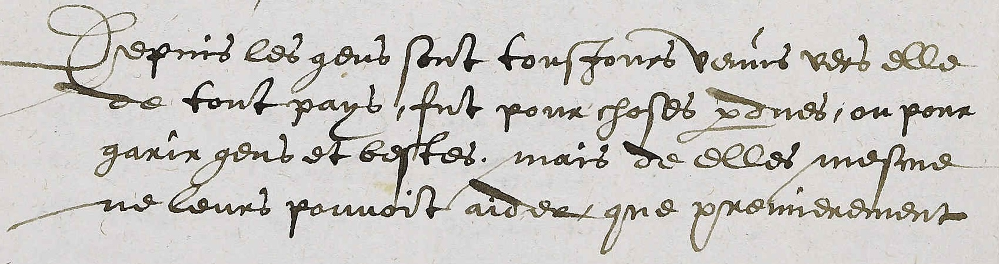
<style scoped>
table { font-size: 24px; }
</style>


| Graphemic | Regularized |
|---|---|
| <span class="junicode">Depui<span class="blue"></span> le<span class="blue"></span> gen<span class="blue"></span> <span class="blue">ſ</span>ont tou<span class="blue">ſ</span>jour<span class="blue"></span> venu<span class="blue"></span> ver<span class="blue"></span> elle</span> | <span class="junicode">Depui<span class="blue">s</span> le<span class="blue">s</span> gen<span class="blue">s</span> <span class="blue">s</span>ont tou<span class="blue">s</span>jour<span class="blue">s</span> venu<span class="blue">s</span> ver<span class="blue">s</span> elle</span> |
| <span class="junicode">de tout pay<span class="blue"></span>, fut pour cho<span class="blue">ſ</span>e<span class="blue"></span> <span class="ora">ꝑ</span>due<span class="blue"></span>, ou pour</span> | <span class="junicode">de tout pay<span class="blue">s</span>, fut pour chose<span class="blue">s</span> <span class="ora">per</span>due<span class="blue">s</span>, ou pour</span> |
| <span class="junicode">garir gen<span class="blue"></span> et beste<span class="blue"></span>. mais de elle<span class="blue"></span> me<span class="blue">ſ</span>me</span> | <span class="junicode">garir gen<span class="blue">s</span> et beste<span class="blue">s</span>. mais de elle<span class="blue">s</span> me<span class="blue">s</span>me</span> |
| <span class="junicode">ne leur<span class="blue"></span> pou<span class="red">u</span>oit aider que premierement</span> | <span class="junicode">ne leur<span class="blue">s</span> pou<span class="red">v</span>oit aider que premierement</span> |

_Two possible transcriptions of the previous image, with an abbreviation <span class="ora">in orange</span>, variations of _s_ <span class="blue">in blue</span>, and a ramist letter <span class="red">in red</span>._

---
## The _mão_ problem

<div style="display:flex; gap:2em; align-items:center;">
<div style="flex:1">


</div>
<div style="flex:1">

_Mão_ is at the same time
- a complete portuguese word
- an italian word in an abbreviated form (_mão_ → _mano_)

<span class="red">If we always develop abbreviations, we are going to create dysfunctional models.</span>

</div>
</div>

---
## The CATMuS project

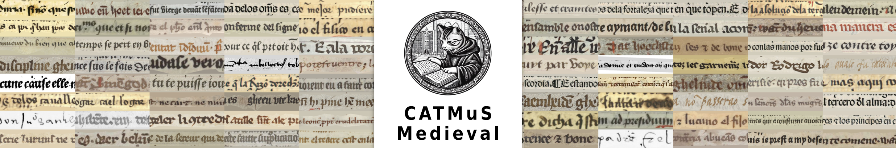

- CATMuS: Consistent Approaches to Transcribing ManuScripts;
- An international initiative bringing together 17 collaborators;
- Partners from Europe and North America;
- Objectives:
  - Develop shared transcription rules;
  - Produce multilingual and diachronic datasets;
  - Develop generic models for automatic handwriting recognition

---
## CATMuS: key principles

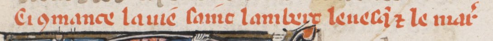
_Geneva, ms. Comites Latentes, 102, fol. 122 ra, image from e-Codices_

| Level | Transcription |
|---|---|
| Normalized | <span class="junicode">Ci conmance la vie saint Lambert l’evesque et le martir</span> |
| Semi-Normalized | <span class="junicode">Ci &lt;con&gt;mance la vie saint Lambert l’eves&lt;que&gt; et le mar&lt;tir&gt;</span> |
| Graphemic | <span class="junicode">Ci ꝯmance la uie saint lambert leuesq̃ ⁊ le mar̾</span> |
| Graphetic | <span class="junicode">Cı ꝯmnce l uíe ſínt lmbert leueſq̃  le mr̾</span> |

_Different level of transcriptions_

A graphemic approach is the key to build robust multilingual and diachronic models.