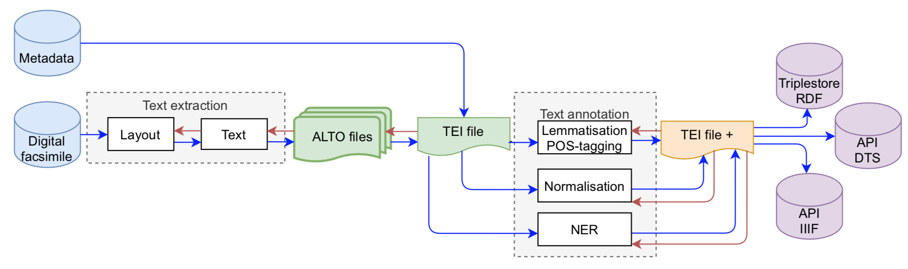
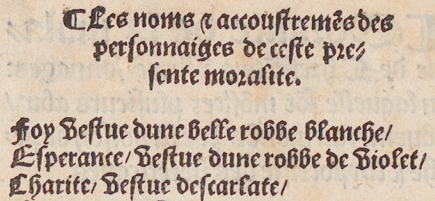
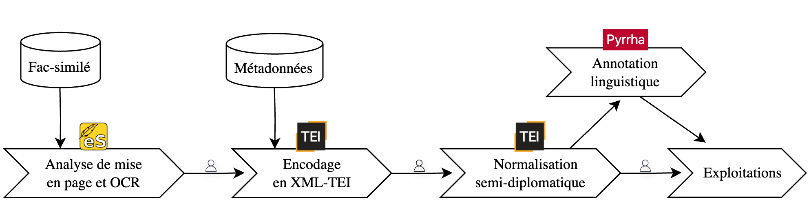

<style>
img[alt~="center"] {
  display: block;
  margin: 0 auto;
}
h1 {
  font-size: 46px;
  color: darkred;
}
h2 {
  font-size: 38px;
  color: darkred;
}

.junicode { font-family: Junicode; }
.blue { color: blue; }
.red { color: red; }
.ora { color: orange; }

</style>

Introduction à la philologie computationnelle

# Normaliser (automatiquement)

Simon Gabay

<a style="float:right; width: 20%;" rel="license" href="http://creativecommons.org/licenses/by-sa/4.0/"></a>

---
## Où en sommes-nous?



Nous savons segmenter une page (cours 3), la transcrire (cours 4) et l'encoder (cours 5). Mais le texte obtenu est-il **lisible**?

---
# Pourquoi normaliser?

---
## Ce que produit l'OCR



<!--
---
_Matthieu Malingre, Moralité de la maladie de Chrestienté, [Neuchâtel, Pierre de Vingle], 1533_
-->
Transcription graphématique (cours 4):

<span class="junicode">¶ Les noms <span class="ora">7</span> accoustrem<span class="ora">ẽ</span>s 
des personnaiges de ceste pre<span class="blue">¬
</span>sente moralite.
Foy <span class="red">u</span>estue <span class="red">dune</span> belle robbe blanche/
Esperance/ <span class="red">u</span>estue <span class="red">dune</span> robbe de <span class="red">u</span>iolet/</span>

---
## Un texte fidèle, mais difficile à utiliser

La transcription graphématique est **juste**: elle respecte le document. Mais:

- les <span class="ora">abréviations</span> ne sont pas développées (_7_ pour _et_, le tilde pour un _n_);
- _u_ et _v_, _i_ et _j_ ne sont pas distingués (_uestue_);
- les mots sont <span class="red">agglutinés</span> (_dune_ pour _d'une_);
- des mots sont <span class="blue">coupés</span> en fin de ligne (_pre¬sente_).

Pour un lecteur, c'est pénible. Pour une machine, c'est pire: chercher _vestue_ ne trouve pas _uestue_, et un outil de lemmatisation ne reconnaîtra pas _dune_.

---
## Normaliser

**Normaliser**, c'est faire passer un texte d'un état de langue à un autre, en suivant des règles décidées à l'avance.

| Transcription graphématique | Normalisation semi-diplomatique |
|---|---|
| ¶ Les noms 7 accoustremẽs des | ¶ Les noms et accoustremens des |
| personnaiges de ceste pre¬ | personnaiges de ceste pre¬ |
| sente moralite. | sente moralite. |
| Foy uestue dune belle robbe blanche/ | Foy vestue d'une belle robbe blanche/ |
| Esperance/ uestue dune robbe de uiolet/ | Esperance/ vestue d'une robbe de violet/ |
| Charite/ uestue descarlate/ | Charite/ vestue d'escarlate/ |

_Solfrini et al., 2025_

---
## Une étape de la chaîne



La normalisation se place **après** l'OCR et **avant** l'annotation linguistique (lemmatisation, étiquetage) et l'exploitation du texte. Le petit personnage rappelle qu'à chaque étape, un humain vérifie.

---
## Transcrire n'est pas éditer

Développer une abréviation, distinguer _u_ et _v_, ajouter une apostrophe: ce sont déjà des **interprétations**, pas de la simple lecture.

| Niveau | _Geneva, Com. Lat. 102, fol. 122a_ |
|---|---|
| Graphématique | <span class="junicode">Ci ꝯmance la uie saint lambert leuesq̃ ⁊ le mar̾</span> |
| Normalisé | <span class="junicode">Ci conmance la vie saint Lambert l'evesque et le martir</span> |

Si l'OCR produit directement un texte normalisé, ces choix deviennent **invisibles**: on ne sait plus ce qui était écrit, ni ce que la machine a décidé.

---
## Un exemple de « faux silencieux »

Dans la chanson de _Floovant_, le même signe <span class="junicode">⁊</span> vaut tantôt _et_, tantôt _e_ (la préposition).

L'éditeur l'a partout développé en _et_: la différence a **disparu sans laisser de trace**. Les études linguistiques fondées sur des éditions normalisées (comme l'_Atlas_ de Dees, 1987) héritent de ces choix sans pouvoir les voir.

Avec une machine, le risque change d'échelle: des milliers de décisions de ce type, prises sans contrôle, sur des millions de pages (Pinche et Clérice, 2026).

---
## Trois couches séparées

Pour garder la trace des décisions, on sépare les étapes (Pinche et Clérice, 2026):

1. **Transcription graphématique**: ce que l'on **voit** sur la page (cours 4);
2. **Normalisation pré-éditoriale**: l'interprétation **linguistique** (abréviations, _u_/_v_, apostrophes…);
3. **Édition savante**: l'interprétation **contextuelle** (ponctuation, notes, corrections, apparat).

Chaque couche est conservée et peut être vérifiée. C'est l'objet de ce cours: la **deuxième couche**.

---
# Jusqu'où normaliser?

---
## Plusieurs niveaux possibles


Toutes les différences ne sont pas de même nature: certaines sont **graphiques** (_ſ_/_s_), d'autres sont des différences de **segmentation** (_long temps_), d'autres reflètent une **évolution de la langue** (_estoit_/_était_).

---
<style scoped>
table {
    font-size: 20px;
}
</style>

## Semi-diplomatique ou modernisé?

| Source | Semi-diplomatique | Modernisé |
|---|---|---|
| plus glorieux qui fuſſent alors en | plus glorieux qui fussent alors en | plus glorieux qui fussent alors en |
| tout l'Vniuers, le Ciel ennemy de | tout l'Univers, le Ciel ennemy de | tout l'Univers, le Ciel ennemi de |
| l'oiſiueté, & du vice, ietta les fon- | l'oisiveté, & du vice, jetta les fon- | l'oisiveté, et du vice, jeta les fon- |
| dont l'eſclat venant à eſbloüir les | dont l'esclat venant à esbloüir les | dont l'éclat venant à éblouir les |

- **Semi-diplomatique**: on intervient sur le « vêtement graphique », sans toucher à la langue.
- **Modernisé**: on aligne sur le français d'aujourd'hui, au risque d'effacer ce qui intéresse l'historien de la langue.

Le choix dépend de la question de recherche et du public visé.

---
## Des règles explicites

Exemple: les règles du projet SETAF pour le français des années 1530 (Solfrini et al., 2025)

- distinguer _u_/_v_ et _i_/_j_ (_vniuers_ → _univers_);
- développer **toutes** les abréviations;
- corriger les coquilles manifestes de l'imprimeur;
- ajouter l'apostrophe (_larbre_ → _l'arbre_) et séparer les mots agglutinés (_tresriche_ → _tres riche_);
- distinguer le trait d'union (_-_) et la coupure de fin de ligne (_¬_).

On **ne touche pas** aux accents, à la ponctuation, à la grammaire, à la syntaxe ni au lexique: _robbe_ reste _robbe_.

---
## Ce qu'il ne faut pas normaliser

Normaliser, c'est aussi savoir **s'abstenir** (Clérice et al., 2026):

- une abréviation de nom propre sans contexte: _S. Parisiensis_ peut être _Stephanus_, _Severinus_… on garde _S._;
- un passage illisible ou très abîmé par l'OCR: le « corriger » reviendrait à **inventer**;
- les nombres (chiffres romains, fractions…): aucune convention commune pour l'instant;
- les variantes d'orthographe d'un même texte (_molt_ et _moult_ sur la même page): on ne choisit pas à la place de l'auteur ou du copiste.

---
## Il n'y a pas une seule bonne réponse

Deux autres projets sur le français du XVIe siècle font d'autres choix:

| | SETAF | Epistemon (BVH) | RCnum |
|---|---|---|---|
| _u_/_v_, _i_/_j_ | oui | oui | non |
| abréviations | oui | oui | non précisé |
| accents | non | non | oui |
| noms propres | non | non | oui |

Une normalisation est toujours **un choix éditorial**: il faut l'écrire, le justifier et l'appliquer de façon cohérente. C'est la condition pour qu'une machine puisse l'apprendre.

---
## Exercice 1 (15 min)

Normalisez à la main, selon les règles SETAF, ces lignes graphématiques:

<span class="junicode">Foy uestue dune belle robbe blanche/
Esperance/ uestue dune robbe de uiolet/
Charite/ uestue descarlate/
Le monde ennemy de loisiuete 7 du uice</span>

1. Quels changements avez-vous faits? Classez-les (abréviation, _u_/_v_, apostrophe…).
2. Comparez avec votre voisin ou voisine: où n'êtes-vous pas d'accord?
3. Lequel de ces changements vous semble le plus difficile à confier à une machine?

---
# Automatiser

---
## Première idée: des règles

On peut écrire des règles de « rechercher-remplacer »:

- _ſ_ → _s_: toujours vrai, facile;
- _7_ → _et_: presque toujours vrai;
- _u_ → _v_ en début de mot: _uestue_ → _vestue_… mais _une_ → _vne_?
- _d_ + voyelle → _d'_: _dune_ → _d'une_… mais _dame_ → _d'ame_?

Les règles marchent pour les cas simples, mais la langue est pleine d'exceptions. Il faudrait des milliers de règles, et elles se contrediraient.

---
## Deuxième idée: apprendre par l'exemple

On montre à la machine des milliers de lignes **avant / après**, et elle apprend seule les régularités:

| Source | Cible |
|---|---|
| Foy uestue dune belle robbe blanche/ | Foy vestue d'une belle robbe blanche/ |
| Le monde ennemy de loisiuete 7 du uice | Le monde ennemy de l'oisivete et du vice |

C'est le principe du **corpus parallèle**, emprunté à la **traduction automatique**: normaliser, c'est « traduire » d'un état de langue à un autre, beaucoup plus proche que l'anglais du français.

---
## Règles ou apprentissage: que gagne-t-on?

Sur du français du XVIIe siècle à moderniser (Bawden et al., 2022), part des mots correctement normalisés:

| Méthode | Mots corrects |
|---|---|
| Ne rien changer | 73 % |
| Règles écrites à la main | 89 % |
| Apprentissage sur un corpus parallèle | 96-97 % |

Les règles sont plus **prudentes**: elles modifient peu, et se trompent donc peu. Les modèles appris modifient davantage, et réussissent mieux… mais peuvent aussi **trop** normaliser.

---
## Ce qu'il faut pour apprendre

Le projet SETAF a normalisé à la main **15 imprimés** des années 1530, soit environ **38 000 lignes**.

Comme pour l'OCR (cours 2 et 4):
- on réserve des lignes pour l'**entraînement**, d'autres pour le **test**;
- le test se fait sur un texte que le modèle n'a jamais vu (ici, la _Moralité_);
- on compare ce que produit la machine à la normalisation faite à la main.

Résultat: environ **95 %** des caractères sont corrects (_FreEM SemiD norm_, Solfrini 2025).

---
## Lire les erreurs

Un bon score ne dispense pas de **relire**. Erreurs typiques du modèle:

- _descarlate_ n'est pas coupé en _d'escarlate_: la machine n'a pas « vu » le mot;
- _dame_ devient _d'ame_: la machine applique une régularité là où il ne fallait pas, et **change le sens**.

Ce sont exactement les cas qui posaient problème aux règles écrites à la main: les difficultés philologiques ne disparaissent pas avec l'automatisation.

Attention aussi aux **scores**: un modèle d'OCR qui développe les abréviations obtient souvent un meilleur score qu'un modèle qui les garde, alors qu'il interprète davantage (Pinche et Clérice, 2026).

---
# Des modèles de langue aux LLM

---
## Une évolution rapide

Sans entrer dans la technique, retenons trois générations d'outils:

1. **Des modèles spécialisés**, entraînés pour une seule tâche sur un petit corpus (comme _FreEM SemiD norm_). Efficaces et peu coûteux, mais limités à ce qu'ils ont vu.
2. **Des modèles de langue** (_transformers_), entraînés d'abord sur beaucoup de textes, puis spécialisés sur le français ancien. Ils « connaissent » mieux la langue. Exemple: pour l'ancien français et le latin, on a aligné automatiquement des millions de lignes d'OCR avec des **éditions déjà publiées** pour fabriquer les exemples (Clérice et al., 2026).
3. **Les grands modèles de langue (LLM)** comme ChatGPT, Claude, Mistral: généralistes, on leur parle en langue naturelle.

La tendance: partir d'un modèle qui connaît déjà la langue, plutôt que de tout apprendre à partir de rien.

---
## Les LLM comme assistants

Un LLM peut aider le philologue:

- proposer un **premier jet** de normalisation, à partir des règles données en consigne;
- **expliquer** une abréviation ou une forme ancienne;
- **produire des exemples** pour entraîner un modèle spécialisé (données dites « synthétiques »);
- vérifier la **cohérence** d'une normalisation faite à la main.

Il ne remplace ni les règles, ni la vérification humaine.

---
## Les limites

- Il **modernise** volontiers, même quand on lui demande de ne pas le faire (_robbe_ → _robe_);
- il peut **inventer** (« halluciner ») un mot ou une leçon;
- il ne donne pas toujours la même réponse deux fois: le résultat est difficile à **reproduire**;
- il coûte cher sur de gros corpus, et l'on envoie ses textes à une entreprise privée (question de la **souveraineté** des données);
- on ne sait pas sur quels textes il a été entraîné.

Pour un corpus de recherche, il reste un **outil d'aide**, pas une autorité.

---
## Exercice 2 (20 min)

Demandez à un LLM de normaliser les lignes de l'exercice 1:

```
Normalise ces lignes de français du XVIe siècle selon les règles suivantes :
distingue u/v et i/j, développe les abréviations, ajoute les apostrophes,
sépare les mots agglutinés. Ne modernise pas l'orthographe, ne touche ni
aux accents, ni à la ponctuation, ni au vocabulaire.

Foy uestue dune belle robbe blanche/
...
```

1. Comparez avec votre propre normalisation: où sont les différences?
2. Le LLM a-t-il respecté la consigne « ne pas moderniser »?
3. Relancez la même demande: obtenez-vous le même résultat?

---
# Garder les deux versions

---
## Normaliser sans effacer

On ne remplace pas la transcription: on **ajoute** une couche. En XML-TEI (cours 5), l'élément `<choice>` conserve la forme originale (`<orig>`) et la forme normalisée (`<reg>`):

```xml
<l>Foy
 <choice>
  <orig>uestue</orig>
  <reg>vestue</reg>
 </choice>
 <choice>
   <orig>dune</orig>
   <reg>d'une</reg>
 </choice>
   belle robbe blanche/
</l>
```

Le lecteur, ou le programme, choisit la version qu'il veut afficher ou analyser.

---
## Bilan

- L'OCR produit un texte **fidèle** mais difficile à lire et à exploiter.
- **Normaliser** est un choix éditorial: il faut des règles explicites.
- La machine apprend ces règles **par l'exemple**, grâce à des corpus parallèles faits à la main.
- Les **LLM** sont de bons assistants, mais modernisent, inventent et coûtent: on vérifie toujours.
- On garde **toujours** la version originale à côté de la version normalisée.

---
## Bibliographie

- Rachel Bawden _et al._, « Automatic Normalisation of Early Modern French », _LREC 2022_, https://inria.hal.science/hal-03540226
- Thibault Clérice, Rachel Bawden, Anthony Glaise, Ariane Pinche et David Smith, « Pre-Editorial Normalization for Automatically Transcribed Medieval Manuscripts in Old French and Latin », 2026, https://hal.science/hal-05514246
- Simon Gabay, Marine Riguet et Loïc Barrault, « A Workflow For On The Fly Normalisation Of 17th c. French », _DH2019_, https://hal.science/hal-02276150
- Ariane Pinche et Thibault Clérice, « The Transcription/Edition Distinction as a Foundation for Trustworthy Automatic Text Recognition », 2026, https://hal.science/hal-05662155
- Raphael Rubino _et al._, « Normalizing without Modernizing: Keeping Historical Wordforms of Middle French while Reducing Spelling Variants », _Findings of NAACL 2024_, https://aclanthology.org/2024.findings-naacl.215/
- Sonia Solfrini _et al._, « Normaliser le moyen français : du graphématique au semi-diplomatique », _CORIA-TALN-RJC 2025_
- Modèle et données _FreEM SemiD norm_: https://github.com/soniasol/FreEM-SemiD-norm
- Epistemon, _Principes éditoriaux_: https://www.bvh.univ-tours.fr/Epistemon/principeseditoriaux.asp
