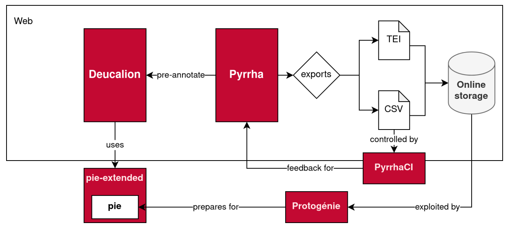
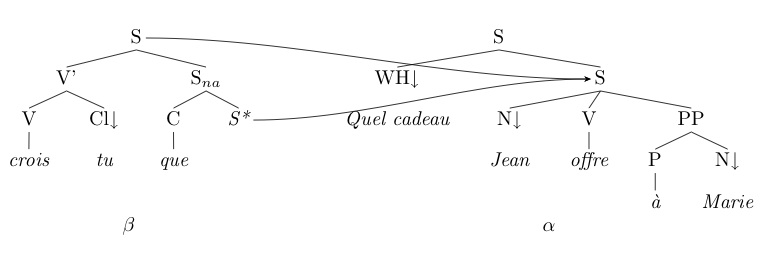
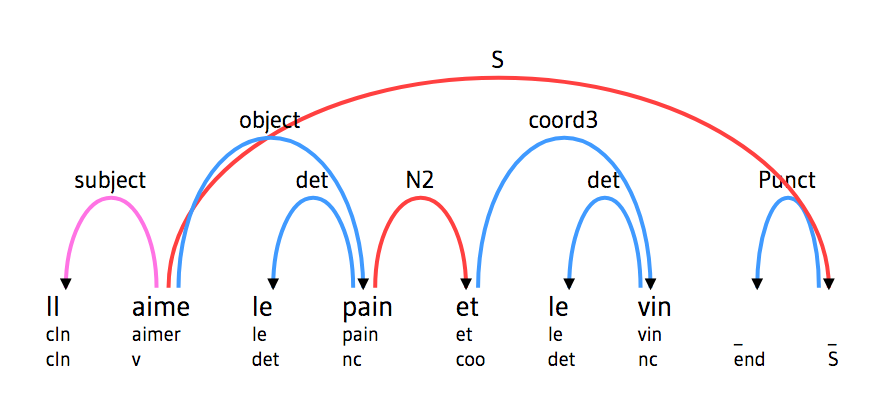
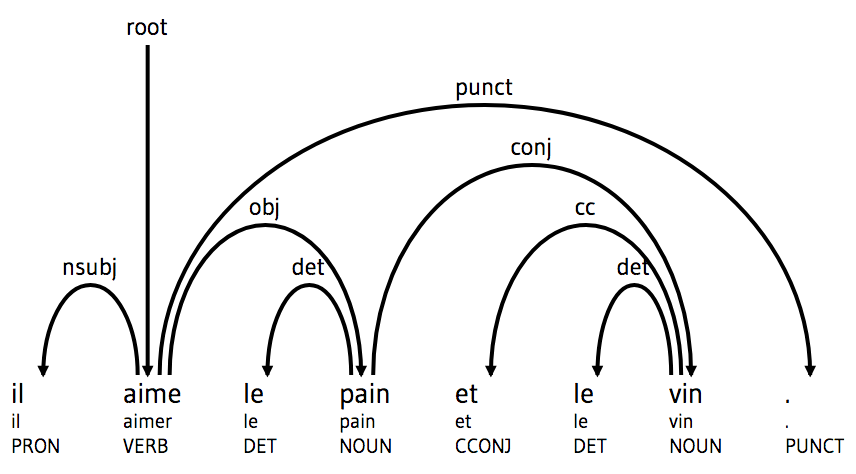

<style>
img[alt~="center"] {
  display: block;
  margin: 0 auto;
}
h1 {
  font-size: 46px;
  color: darkred;
}
h2 {
  font-size: 38px;
  color: darkred;
}

.junicode { font-family: Junicode; }
.blue { color: blue; }
.red { color: red; }
.ora { color: orange; }

</style>

Introduction à la philologie computationnelle

# L'annotation linguistique

Simon Gabay

<a rel="license" href="http://creativecommons.org/licenses/by/4.0/"></a>


---
# Du corpus

---
## Le matériau

Comme toute les sciences, la stylistique s'appuie sur des preuves, qu'il s'agit de collecter, puis d'analyser. Ces preuves sont de divers ordres:

1. Énonciation
2. Textualité
3. Syntaxe
4. Rythme et sonorités
5. Lexique
6. Figures

---
## L'intuition computationnelle

1. L'informatique peut-elle nous aider à accélérer ces relevés?
2. L'informatique peut-elle nous aider à relever autre choses?

Les approches computationnelle de la langue, mais aussi de la linguistique, font le pari que oui.

---
## Le corpus

Una approche computationnelle est quantitative, et donc fondée sur des fréquences, mais aussi des différences de fréquence. Celles-ci sont calculées sur des textes, et le choix de ces textes détermine la fiabilité des résultats.

>Une approche quantitative requiert une fondation solide de la base de données et dans l'analyse et la catégorisation des données.
>
>_A quantitative perspective requires a very solid foundation in the preparation of the data base and in the analysis and categorisation of the data._

Jucker, "Corpus pragmatics", 2018

---
## Typologie

On va donc avoir recours à un corpus. Aarts (2011) en propose une typologie simple:
* _Balanced corpora_: on fournit une image plus ou moins représentative d'une langue, d'état de langue, d'un champ…
* _Full-text corpora_: on fournit des textes complets
* _Parallel corpora_: on fournit des textes en plusieurs langues, ou de plusieurs versions d'une même langue (par exemple des dialectes)

Il existe évidemment une tension entre:
* Peu de données richement contextualisées
* Des corpus de grande taille, mais avec peu d'information supplémentaire

---
## Balancement

Aarts propose en 2011 la notion de _balanced corpus_, mais la création de tels corpus a commencé dans les années 60:
* Le _London-Lund Corpus of Spoken English_ (LLC)
* Le _Brown Corpus_ de l'anglais américain écrit
* Le _Lancaster-Oslo-Bergen_ (LOB) de l'anglais britannique écrit.

Nous avons aussi désormais des corpus diachroniquement balancés:
* Le _Early Modern English Medical Texts_ (EMEMT)

---
## Représentativité

>Un corpus est pensé comme représentatif de la variété de langue qu'il est supposé représenté si les découvertes basées sur son contenu peuvent être généralisées à ladite variété de langue.
>
>_A corpus is thought to be representative of the language variety it is supposed to represent if the findings based on its contents can be generalized to the said language variety._

Leech, "The State of the Art in Corpus Linguistics", 1991

---
## Représentativité (II)

Mais la représentativité est un concept fluide, très lié au questions de recherche:
* Faut-il un corpus général?
* Faut-il un corpus spécialisé? Si oui comment?

**Toute prétention à la représentativité et au balancement doit être interprétée en termes relatifs**

---
## Linguistique de corpus vs textométrie

>La textométrie ne se confond pas avec la linguistique de corpus. Toutes deux fondent leurs investigations sur un corpus numérique, dont la constitution est déterminante. Comme son nom l'indique, la linguistique de corpus poursuit un objectif de description et de modélisation de la langue. La textométrie, centrée sur le texte, a pu être mobilisée par diverses sciences humaines (histoire, littérature, sciences politiques...).
>\[La textométrie] se caractérise notamment par certains calculs fondateurs, statistiques (les spécificités, les cooccurrences) ou non (les segments répétés, les concordances), et accorde une place fondamentale au « retour au texte » (bien outillé dans les logiciels) pour interpréter les unités (généralement des mots) sélectionnées par les calculs.
Pincemin, "Sémantique interprétative et textométrie", 2012.

---
### Textométrie vs stylométrie

>La lexicométrie s’est d’abord définie comme étude du vocabulaire, avant qu’on ne parle de logométrie – comme étude globale d’un discours – ou encore de textométrie, comme analyse d’un texte. Le terme de stylométrie, quant à lui, fonde sa spécificité dans la caractérisation d’une écriture.

Magri-Mourgues, "Stylistique et statistiques. Le corpus textuel et hyperbase", 2016,

---
# Les outils

---
## Plus que le mot

Evidemment, ces recherches s'appuient sur le texte numérisé, et donc les mots qui le constitue. En plus de la recherche plein texte, nous pouvons désormais compter sur des outils qui ajoutent un surcroît d'information, et permettent des recherche jusqu'à présent inédites.

Ces informations ne sont cependant pas simples à ajouter, car elles dépendent de choix complexes qui ont un impact très fort sur les résultats lors de la fouille de texte.

---
## Le token

Le token (en français "jeton") n'est pas un mot, c'est une entité lexicale. C'est une chaîne de caractères (_string_) entre deux délimiteurs. Ces délimiteurs sont eux-mêmes une chaîne de caractères (usuellement virgule, point-virgule… éventuellement précédés d'un espace insécable), dont le choix est (relativement libre).

Prenons l'exemple de "aujourd'hui". Nous avons un mot qui est composé de:
1. un token: _aujourd'hui_
2. deux tokens: _aujourd'_ et _hui_
3. trois tokens: _aujourd_, _'_ et _hui_

---
## Service en ligne

Il existe des services en ligne: https://dh.chartes.psl.eu/deucalion/freem

Vous pouvez faire un essai avec le texte suivant:

```
LA Cigale ayant chanté
Tout l’Eſté,
Se trouva fort dépourvuë
Quand la biſe fut venuë.
```

Evidemment le résultat n'est pas magique. Il faut d'abord entraîner un modèle.

---
## Cycle de travail



Thibault Clérice, Vincent Jolivet, Julien Pilla. "Building infrastructure for annotating medieval, classical and pre-orthographic languages: the Pyrrha ecosystem." _Digital Humanities 2022 (DH2022)_, Jul 2022, Tokyo, Japan. [⟨hal-03606756⟩](https://shs.hal.science/hal-03606756v1).

---

# Annotation I: lemmatiser

---
## Définition

> La lemmatisation désigne un **traitement lexical** apporté à un texte en vue de son analyse. Ce traitement consiste à appliquer aux **occurrences des lexèmes** sujets à flexion (en français, verbes, substantifs, adjectifs) **un codage** renvoyant à leur entrée lexicale commune (« **forme canonique** » enregistrée dans les dictionnaires de la langue, le plus couramment), que l'on désigne sous le terme de lemme.

Un exemple:

| Texte | Les | étoiles | luisent | dans | la | nuit | noire | . |
| ------|-----|---------|---------|------|----|------|-------|---|
| Lemme | Le  | étoile  | luire   | dans | le | nuit | noir  | . |

---
## Un lemmatiseur, qu'est-ce que c'est concrètement?

* Faire passer de la forme fléchie à son lemme.
* Ce lemme est une forme canonique. Dire qu'elle n'est pas fléchie est problématique: le masculin n'est-il pas aussi fléchi? (cf. notion de flexion zéro)
* Il faut faire la différence entre le lemme et le mot vedette de l'entrée du dictionnaire
* Il faut s'appuyer sur un référentiel, comme _Morphalou_, car il faut éviter qu'un même mot ait deux lemmes (_œil_, _clef_ …)

---
## Lemmatiser: le (pré-)problème de la tokénisation

* _pomme_
* _pomme de terre_
* _aujourd'hui_
* _c'est_
* _tire-bouchon_
* _veux-tu_
* _Celui-ci_
* _treshumble_ (XVIIe s.)
* _C'est M. Dupont._
* _bien que_
* _parce que_
* _ce pendant_ (XVIe s.)

---

## Lemmatiser: cas limites

Il y a un problème avec les homographes (impossibles à traiter avec une approche par lexique):

> _Il **est** à l'**est** de la ville._

> _Je **suis** légaliste: je **suis** la loi._

L'homographie peut être accidentelle (OCR, anciens états de langue):

> _Il va **a** Paris._

Il peut aussi y avoir un problème avec le polymorphisme:

>_Il y a **besoing** et **besoin**._

---
## Lemmatiser: cas problématiques

* _comtesse_
* _va-t-il_
* _Jehan_
* _Jeanne_
* _Vespasianus_ 
* _François de La Rochefoucauld_
* _Oeuf_
* _Égypte_
* _aux_
* _dudit_

---
## Lemmatiser: cas problématiques

* _comtesse_ -> Féminin? ou masculin?
* _va-t-il_ -> Que faire du _-t-_ euphonique?
* _Jehan_ -> normaliser les noms?
* _Jeanne_ -> Féminiser les noms propres?
* _Vespasianus_ -> Moderniser les noms?
* _François de La Rochefoucauld_ -> _le_ ou _La_?
* _Oeuf_ -> comment traiter les ligatures?
* _Égypte_ -> garder les accents sur les majuscules?
* _aux_ -> lemme composé _à_le_? _à+le_?
* _dudit_ -> lemme composé "triple" _de_le_dit_?

---
## Lemmatiser: quelques cas

* _Il me demande à moi_
* _Un retour éclatant_
* _Une âme affligée_
* _Les .X. comandemenz_ (XVe s.)
* _le pater noster_
* _s'enfuir_
* _Le Père R._
*  _il ne leur manquera rien_ vs _leur vif éclat_
* _qui n'en veut?_ (corpus oral)
* _Y z'y vont_
---
## Lemmatiser: quelques cas

* _Il me demande à moi_ -> moi=_je_ ou _moi_?
* _Un retour éclatant_ -> adj ou participe présent?
* _Une âme affligée_ -> adj ou participe passé?
* _Les .X. commandements_ -> que faire des chiffres?
* _le pater noster_ -> comment lemmatiser les emprunts?
* _s'enfuir_ -> que faire des pronominaux (_abaisser_ vs _s'abaisser_?)
* _Le Père R._ -> Que faire des noms abrégés?
*  _il ne leur manquera rien_ -> pronom _il_ vs déterminant possessif _leur_
* _qui n'en veut?_ -> particule clitique de fausse liaison
* _Y z'y vont_ -> transformation euphonique _ils_>_y_ sur le modèle de la liaison+ particule enclitique formant un pronom(?)


---

| token |
|-------|
| Je    |
| mange |
| une   |
| pomme |

---

| token | Lemme  |
|-------|--------|
| Je    | je     |
| mange | manger |
| une   | un     |
| pomme | pomme  |

---
# Annotation II: parties du discours

---
## Le POS tagger

On parle de _POS_ pour _part of speech_, "partie du discours". Un _POS tagger_ permet donc d'accoler à chaque token sa nature grammaticale.

Pour cela on utilise un jeu d'étiquettes précis: `N` pour le substantif, `Aj`pour l'adjectif, `D` pour le déterminant… Il en existe plusieurs, et il faut choisir, ce qui n'est pas facile.

Il existe des cas limites, comme l'adjectivation (du participe passé, du participe présent…): comment trancher entre étiquetage morphologique et morpho-syntactique?

En plus de la nature, on peut rajouter des informations supplémentaires: le nombre, le genre, le mode, le temps, la personne…

---

| token | Lemme  |
|-------|--------|
| Je    | je     |
| mange | manger |
| une   | un     |
| pomme | pomme  |

---

| token | Lemme  | CATTEX | UDpos | EAGLES   | MULTEX |
|-------|--------|--------|-------|----------|--------|
| Je    | je     | PROper | PRON  | PRON_PER | Pp     |
| mange | manger | VERcjg | VERB  | V_GVRB   | Vv     |
| une   | un     | DERndf | DET   | ART      | Dn     |
| pomme | pomme  | NOMcom | NOUN  | NN       | Nc     |

---


| Token  |
|--------|
|de      |
|ce      |
|trait   |
|perçant |
|mon     |
|coeur   |
|est     |
|blessé  |
| .      |
|C'      |
|est     |
|moi     |


---
.

| Token  | Lemme   | POS    | Morphologie                           |
|--------|---------|--------|---------------------------------------|
|de      | de      | PRE    | MORPH=empty                           |
|ce      | ce      | DETdem | NOMB.=s\|GENRE=m                      |
|trait   | trait   | NOMcom | NOMB.=s\|GENRE=m                      |
|perçant | percer  | VERppa | NOMB.=s\|GENRE=m                      |
|mon     | mon     | DETpos | PERS.=1\|NOMB.=s\|GENRE=m             |
|coeur   | cœur    | NOMcom | NOMB.=s\|GENRE=m                      |
|est     | être    | VERcjg | MODE=ind\|TEMPS=pst\|PERS.=3\|NOMB.=s |
|blessé  | blesser | VERppe | NOMB.=s\|GENRE=m                      |
| .      | .       | PONfrt |                                       |
|C'      | ce      | PROdem | NOMB.=s\|GENRE=n                      |
|est     | être    | VERcjg | MODE=ind\|TEMPS=pst\|PERS.=3\|NOMB.=s |
|moi     | je      | PROper | PERS.=1\|NOMB.=s\|GENRE=x\|CAS=i      |


---
## Parties du discours: quelques cas

* _la Fortune_
* _un retour éclatant_
* _mon Dieu_ vs _le dieu Jupiter_
* _parce que_
* _vive les vacances_
* _voici_
* _18 ans_ vs _ses 18 ans_
* _le pater noster_
* _le Père R._

---
## Parties du discours: quelques cas

* _la Fortune_ -> `NOMpro` ou `NOMcom`
* _un retour éclatant_ -> `VERppa`
* _mon Dieu_ (détermination non pertinente -> `NOMpro`) vs _le dieu Jupiter_ (`NOMcom`)
* _parce que_ -> `ADVgen` par analogie (_bien que_)
* _vive les vacances_ -> `VERcjg`
* _voici_ -> `VERcjg`
* _18 ans_ `DETcar NOMcom` vs _ses 18 ans_ `DETpos ADJcar NOMcom`
* _le pater noster_ -> `ETR`
* _le Père R._ -> `ABR`

---
## Parties du discours: quelques cas

* _aux_
* _duquel_
* _Monsieur de La Rochefoucauld_
* _Mesnil montant_ (Ménilmontant)
* _là-dessus_
* _premier_
* _dernier_

---
## Parties du discours: quelques cas

* _aux_ -> `PRE.DETdef`
* _duquel_ -> `PRE.DETrel` ou `PRE.PROrel` ou `PRE.PROint` en fonction du contexte
* _Monsieur de La Rochefoucauld_ -> `NOMcom PRE NOMpro NOMpro`
* _Mesnil montant_ (Ménilmontant) `NOMpro VERppa`
* _là-dessus_ -> `ADVgen PONfbl ADVgen`
* _premier_ -> `ADJord`
* _dernier_ -> `ADJqua`

---

# Annotation III: morphologie

---
## Morphologie: quelques cas

* _je_
* _me_
* _moi_
* _mes_
* _vous êtes odieux_
* _il est clair_
* _J’ai mangé_
* _rien_
* _Julien Sorel_

---
## Morphologie: quelques cas

* _je_ -> `CAS=n` nominatif
* _me_ -> `CAS=r` régime direct
* _moi_-> `CAS=i` régime indirect
* _mes_ -> `PERS.=1|NOMB.=s` ou `PERS.=1|NOMB.=p`
* _vous êtes odieux_ -> Féminin ou masculin? _vous_ `GENRE=x`
* _il est clair_ -> Masculin ou neutre? `NOMB.=s|GENRE=n` ou `NOMB.=s|GENRE=m`?
* _J’ai mangé_ -> `VERcjg MODE=ind|TEMPS=pst` + `VERppe`
* _rien_ -> `MORPH=empty`
* _Julien Sorel_

---

# Annotation IV: la syntaxe

---

## Le parseur

Le parseur permet de faire de l'analyse syntaxique – en anglais on parle de _syntactic parsing_. Il s'agit désormais, en plus du lemme et de la POS de récupérer la fonction dans la phrase.

Cette approche s'appuie beaucoup sur la grammaire d'arbres adjoints (TAG, _Tree-adjoining grammar_ ) qui représente la phrase sous la forme de graph.



Source: [Wikipedia](https://commons.wikimedia.org/wiki/File:Recursion-tag-fr.jpg?uselang=fr)

---

Exemple

> Il aime le pain et le vin.

---
Comment analyser la coordination?

> Il aime <span style="color:red;">le pain et le vin</span> .

> Il aime <span style="color:red;">le pain</span> <span style="color:blue;">et le vin</span> .

> Il aime <span style="color:red;">le pain</span> <span style="color:green;">et</span> <span style="color:blue;">le vin</span> .

---
DeepXML



---
UD



---
CoNLL

|   | token | Lemme | POS 1 | POS 2 | Morph | Rel. | Fonction  |
|---|-------|-------|-------|-------|-------|------|-----------|
| 1 | Il    | il    | CL    | CLS   | s=suj | 2    | suj       |
| 2 | aime  | aimer | V     | V     | t=pst | 0    | root      |
| 3 | le    | le    | D     | DET   | s=def | 4    | det       |
| 4 | pain  | pain  | N     | NC    | s=c   | 2    | obj       |
| 5 | et    | et    | C     | CC    | s=c   | 4    | coord     |
| 6 | le    | le    | D     | DET   | s=def | 7    | det       |
| 7 | vin   | vin   | N     | NC    | s=c   | 5    | dep_coord |
| 8 | .     | .     | PONCT | PONCT | _     | 2    | ponct     |

---
## Sources

* Thibault Clérice, Matthias Gille Levenson, Lucence Ing, Ariane Pinche, Simon Gabay, Jean-Baptiste Camps, «Lemmatiser des textes et corriger l'annotation grâce à l'apprentissage profond avec Pyrrha », _Humanistica 2021_, Mai 2021, Rennes, France. [⟨hal-03224112⟩](https://hal.archives-ouvertes.fr/hal-03224112).

* Simon Gabay, Jean-Baptiste Camps, Thibault Clérice. "Manuel d'annotation linguistique pour le français moderne (XVIe -XVIIIe siècles) : Version B." 2022. [⟨hal-02571190v2⟩](https://hal.science/hal-02571190).